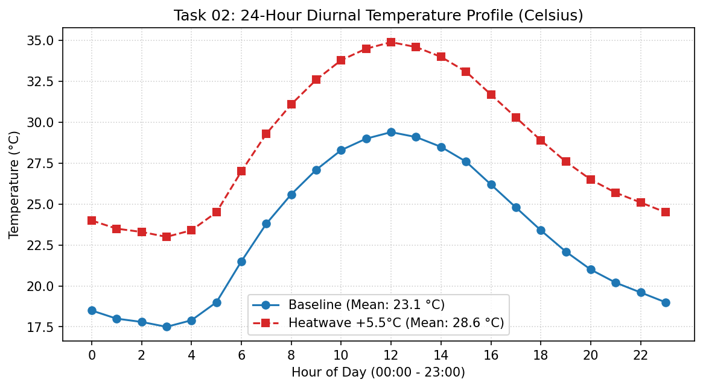
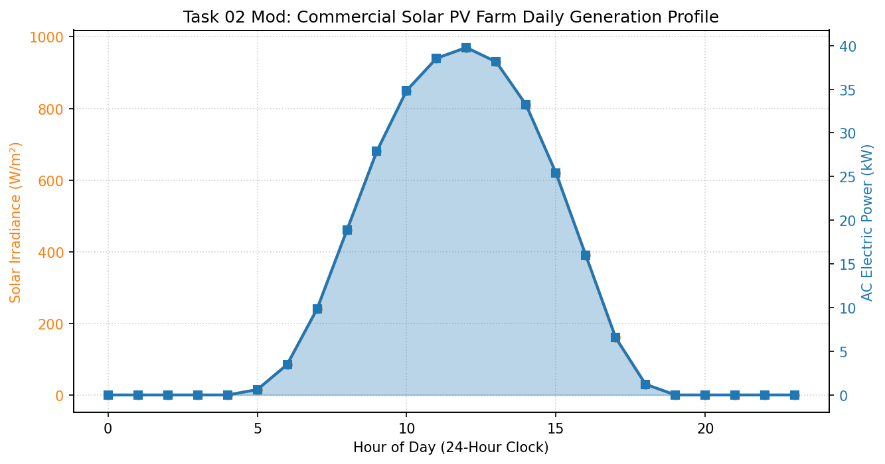

# Task 02: NumPy Arrays and Numerical Computation

## B. Input Values & Mathematical Operation
- **Mathematical Concept:** 1D array representation, vectorized arithmetic, and statistical reduction operations ($\mu, \min, \max$).
- **Input Values:**
  - 24 hourly temperature readings recorded in degrees Celsius:
    $$T_C = [18.5, 18.0, 17.8, 17.5, 17.9, 19.0, 21.5, 23.8, 25.6, 27.1, 28.3, 29.0, 29.4, 29.1, 28.5, 27.6, 26.2, 24.8, 23.4, 22.1, 21.0, 20.2, 19.6, 19.0]$$
- **Mathematical Operations:**
  - Mean temperature: $\mu = \frac{1}{N}\sum_{i=1}^{N} T_{C,i}$
  - Minimum and Maximum: $\min(T_C)$, $\max(T_C)$
  - Vectorized affine unit conversion to Fahrenheit:
    $$T_F = 1.8 \cdot T_C + 32$$

## C. Parameter Modification & Result Change
- **Parameter Modified:** Simulated regional climate heatwave by adding a constant offset $\Delta T = +5.5\text{ }^\circ\text{C}$ across the entire 24-hour diurnal cycle.
- **Quantitative Result Comparison:**
  | Metric | Original Baseline | Modified Heatwave (+5.5 °C) | Absolute Shift |
  | :--- | :--- | :--- | :--- |
  | **Mean Temperature** | $23.12\text{ }^\circ\text{C}$ | $28.62\text{ }^\circ\text{C}$ | $+5.50\text{ }^\circ\text{C}$ |
  | **Minimum Temperature** | $17.50\text{ }^\circ\text{C}$ | $23.00\text{ }^\circ\text{C}$ | $+5.50\text{ }^\circ\text{C}$ |
  | **Maximum Temperature** | $29.40\text{ }^\circ\text{C}$ | $34.90\text{ }^\circ\text{C}$ | $+5.50\text{ }^\circ\text{C}$ |
  | **First Reading (°F)** | $65.30\text{ }^\circ\text{F}$ | $75.20\text{ }^\circ\text{F}$ | $+9.90\text{ }^\circ\text{F}$ |

## D. Output & Graph Interpretation
- The script demonstrates NumPy's ability to broadcast scalar additions and scalar multiplications across arrays without explicit `for` loops. The diurnal curve shows a minimum at 03:00 ($17.5\text{ }^\circ\text{C}$) and peak heating around 12:00 ($29.4\text{ }^\circ\text{C}$). The Fahrenheit conversion illustrates element-wise linear scaling.
- **Original & Comparative Visualization:**
  

---

## E. Modified Real-World Case
- **Script:** [`modified_cases/Task_02_mod.py`](../modified_cases/Task_02_mod.py)
- **Problem Statement:** A 50 kWp commercial solar photovoltaic (PV) facility monitors 24-hour solar irradiance ($W/m^2$). The engineering team requires daily total solar insolation, daytime average irradiance, peak solar power, and total daily electrical energy output ($kWh$) after accounting for temperature derating and inverter efficiency ($PR = 82\%$).
- **New Assumptions & Inputs:**
  - 24 hourly solar irradiance values ($W/m^2$) peaking at $970.0\text{ W/m}^2$ at 12:00.
  - Array capacity: $50.0\text{ kWp}$, System Performance Ratio: $0.82$.
  - AC Power Model: $P_{AC} = \left(\frac{G}{1000}\right) \times 50.0 \times 0.82\text{ kW}$.
- **Output Results:**
  - Peak Solar Irradiance: $970.0\text{ W/m}^2$
  - Daylight Average Irradiance: $512.9\text{ W/m}^2$
  - Peak AC Power Output: $39.77\text{ kW}$
  - Daily Total Electric Energy: $294.38\text{ kWh}$
  - Daily Capacity Factor: $24.53\%$
- **Interpretation:** The generation profile follows a characteristic bell-shaped solar insolation curve between 05:00 and 19:00. NumPy vectorized operations permit instantaneous calculation of AC generation and capacity factor directly from raw environmental sensor streams.
- **Modified Case Visualization:**
  
