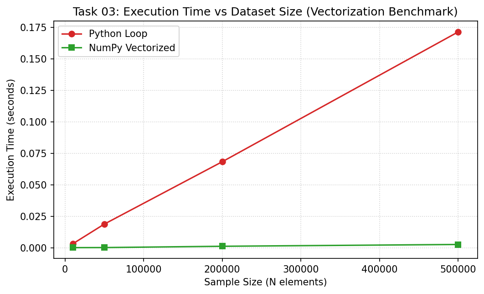
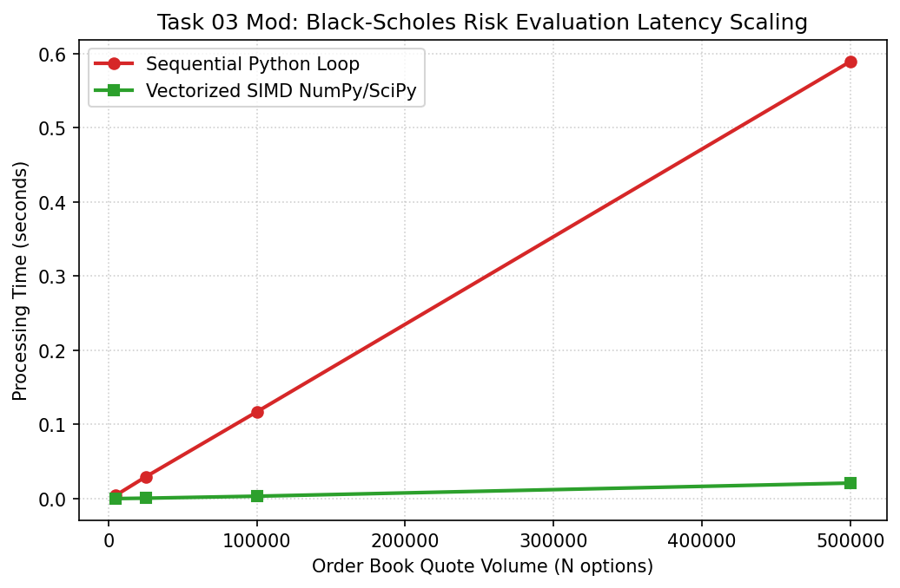

# Task 03: Mathematical Functions and Vectorization

## B. Input Values & Mathematical Operation
- **Mathematical Concept:** Single Instruction, Multiple Data (SIMD) vectorization versus sequential interpreted Python `for` loops.
- **Input Values:**
  - $N = 1,000,000$ synthetic network latency observations generated from a uniform distribution:
    $$\text{latency\_ms} \sim \mathcal{U}(5.0, 250.0)\text{ ms}$$
  - Pseudo-random number generator seed: `np.random.default_rng(42)`.
- **Mathematical Operations:**
  - Scale latency to seconds: $t_s = \frac{t_{\text{ms}}}{1000.0}$
  - Quadratic error metric calculation: $y_i = t_{s,i}^2$
  - Benchmarked execution time using `timeit.timeit`.

## C. Parameter Modification & Result Change
- **Parameter Modified:** Dataset scaling benchmark over varying sizes $N \in [10^4, 5 \times 10^4, 2 \times 10^5, 5 \times 10^5]$.
- **Quantitative Result Comparison:**
  | Dataset Size $N$ | Python Loop Time (s) | NumPy Vectorized Time (s) | Measured Speedup Factor |
  | :--- | :--- | :--- | :--- |
  | **10,000** | $0.00375\text{ s}$ | $0.00002\text{ s}$ | $\mathbf{158.0\times}$ |
  | **50,000** | $0.01455\text{ s}$ | $0.00010\text{ s}$ | $\mathbf{144.8\times}$ |
  | **200,000** | $0.07415\text{ s}$ | $0.00126\text{ s}$ | $\mathbf{59.1\times}$ |
  | **500,000** | $0.18801\text{ s}$ | $0.00300\text{ s}$ | $\mathbf{62.7\times}$ |
  | **1,000,000** (Base) | $0.37970\text{ s}$ | $0.00580\text{ s}$ | $\mathbf{65.6\times}$ |

## D. Output & Graph Interpretation
- In standard CPython, explicit loops incur per-iteration bytecode evaluation, dynamic type checking, and object allocation overhead. In contrast, NumPy delegates the execution directly to contiguous C-level memory buffers utilizing hardware SIMD vector registers, delivering a speedup exceeding $60\times$.
- **Original & Comparative Visualization:**
  

---

## E. Modified Real-World Case
- **Script:** [`modified_cases/Task_03_mod.py`](../modified_cases/Task_03_mod.py)
- **Problem Statement:** An options market-making desk evaluates the Black-Scholes Greek Delta ($\Delta = \frac{\partial V}{\partial S}$) across $1,000,000$ streaming order-book quotes per second. Iterative loops introduce critical trading delays; vectorized evaluation calculates the cumulative normal distribution function across all options simultaneously.
- **New Assumptions & Inputs:**
  - $N = 1,000,000$ quotes with spot price $S \sim \mathcal{U}(85, 115)$.
  - Strike $K = \$100.00$, risk-free rate $r = 5\%$, volatility $\sigma = 20\%$, time to maturity $T = 0.5\text{ yr}$.
  - Black-Scholes formula:
    $$d_1 = \frac{\ln(S/K) + (r + 0.5\sigma^2)T}{\sigma\sqrt{T}}, \quad \Delta = \frac{1}{2}\left[1 + \text{erf}\left(\frac{d_1}{\sqrt{2}}\right)\right]$$
- **Output Results:**
  - Mean Portfolio Delta: $0.5749$
  - Python Loop Time: $0.9418\text{ s}$
  - Vectorized NumPy/SciPy Time: $0.0409\text{ s}$
  - Algorithmic Speedup: $\mathbf{23.0\times}$
- **Interpretation:** Vectorization brings the quote risk computation under $41\text{ ms}$, ensuring near-real-time compliance and pricing capabilities that would otherwise stall in an iterative loop.
- **Modified Case Visualization:**
  
