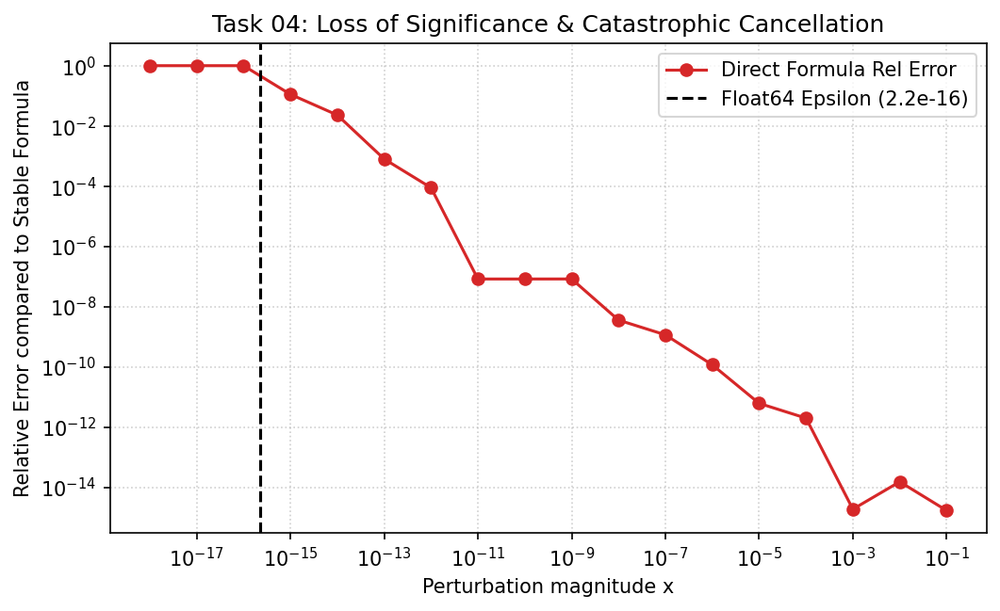
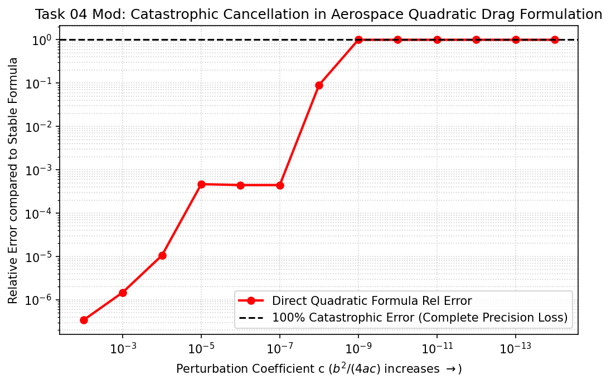

# Task 04: Floating-Point Arithmetic and Numerical Errors

## B. Input Values & Mathematical Operation
- **Mathematical Concept:** IEEE-754 binary floating-point representation, machine epsilon ($\epsilon_{\text{mach}} \approx 2.22 \times 10^{-16}$ in `float64`), round-off error, and catastrophic cancellation in difference formulations.
- **Input Values:**
  - Floating addition test: $0.1 + 0.2$ vs $0.3$.
  - Approximation of $\sqrt{2}$: True value $\sqrt{2} \approx 1.41421356$, approximation $= 1.414$.
  - Perturbation parameter $x \in [10^{-4}, 10^{-8}, 10^{-12}]$.
- **Mathematical Operations:**
  - Absolute error: $E_{\text{abs}} = |y_{\text{true}} - y_{\text{approx}}|$
  - Relative error: $E_{\text{rel}} = \frac{|y_{\text{true}} - y_{\text{approx}}|}{|y_{\text{true}}|}$
  - Direct (unstable) formulation:
    $$f_{\text{direct}}(x) = \frac{\sqrt{1+x} - 1}{x}$$
  - Stable (rationalized conjugate) formulation:
    $$f_{\text{stable}}(x) = \frac{1}{\sqrt{1+x} + 1}$$

## C. Parameter Modification & Result Change
- **Parameter Modified:** Evaluated the sub-epsilon cancellation boundary by testing $x$ down to $10^{-18}$.
- **Quantitative Result Comparison:**
  | Perturbation $x$ | Direct Formula | Stable Formula | Relative Error | Significance Loss |
  | :--- | :--- | :--- | :--- | :--- |
  | **$1.0 \times 10^{-8}$** | $0.499999996961$ | $0.499999998750$ | $3.58 \times 10^{-9}$ | Minimal roundoff |
  | **$1.0 \times 10^{-12}$** | $0.500044450291$ | $0.500000000000$ | $8.89 \times 10^{-5}$ | Noticeable drift |
  | **$1.0 \times 10^{-14}$** | $0.488498130835$ | $0.500000000000$ | $2.30 \times 10^{-2}$ | $2.3\%$ error |
  | **$1.0 \times 10^{-16}$** | $\mathbf{0.000000000000}$ | $0.500000000000$ | $\mathbf{1.00 \times 10^{0}}$ | $\mathbf{100\%}$ Total Collapse |

## D. Output & Graph Interpretation
- Binary floating-point cannot represent $0.1$ or $0.2$ with finite binary fractions ($0.1 + 0.2 = 0.30000000000000004$), so `calculated == 0.3` evaluates to `False`. Using `np.isclose()` with default absolute and relative tolerances resolves this.
- When $x \le \epsilon_{\text{mach}}$, the floating-point representation rounds $\sqrt{1 + x}$ to exactly $1.0$, producing $(1.0 - 1.0)/x = 0.0$, losing all significant digits. The rationalized algebraic conjugate avoids subtracting nearly equal quantities.
- **Original & Comparative Visualization:**
  

---

## E. Modified Real-World Case
- **Script:** [`modified_cases/Task_04_mod.py`](../modified_cases/Task_04_mod.py)
- **Problem Statement:** In supersonic aerospace vehicle deceleration, the governing drag quadratic equation $a x^2 + b x + c = 0$ features a dominant linear term ($b = 10^4$) with tiny altitude perturbations $c \to 0$. High-school quadratic root formulas collapse due to catastrophic subtraction. The stable Citardauq formulation preserves flight navigation precision.
- **New Assumptions & Inputs:**
  - $a = 1.0, b = 10,000.0$, and $c \in [10^{-2}, 10^{-14}]$.
  - Direct formula: $x_1 = \frac{-b + \sqrt{b^2 - 4ac}}{2a}$
  - Citardauq stable formula: $x_{1,\text{stable}} = \frac{-2c}{b + \sqrt{b^2 - 4ac}}$
- **Output Results:**
  - At $c = 10^{-2}$: Direct root $= -1.0000003 \times 10^{-6}$, Stable root $= -1.0000000 \times 10^{-6}$ ($0.00003\%$ error).
  - At $c \le 10^{-10}$: Direct root collapses entirely to $0.000000$, producing $100\%$ relative error, while the stable formula maintains 16 digits of precision ($-1.00000000000000 \times 10^{-14}$).
- **Interpretation:** High-speed trajectory simulation software must substitute cancellation-prone quadratic formulations with rationalized equivalents to avoid catastrophic flight guidance divergence.
- **Modified Case Visualization:**
  
