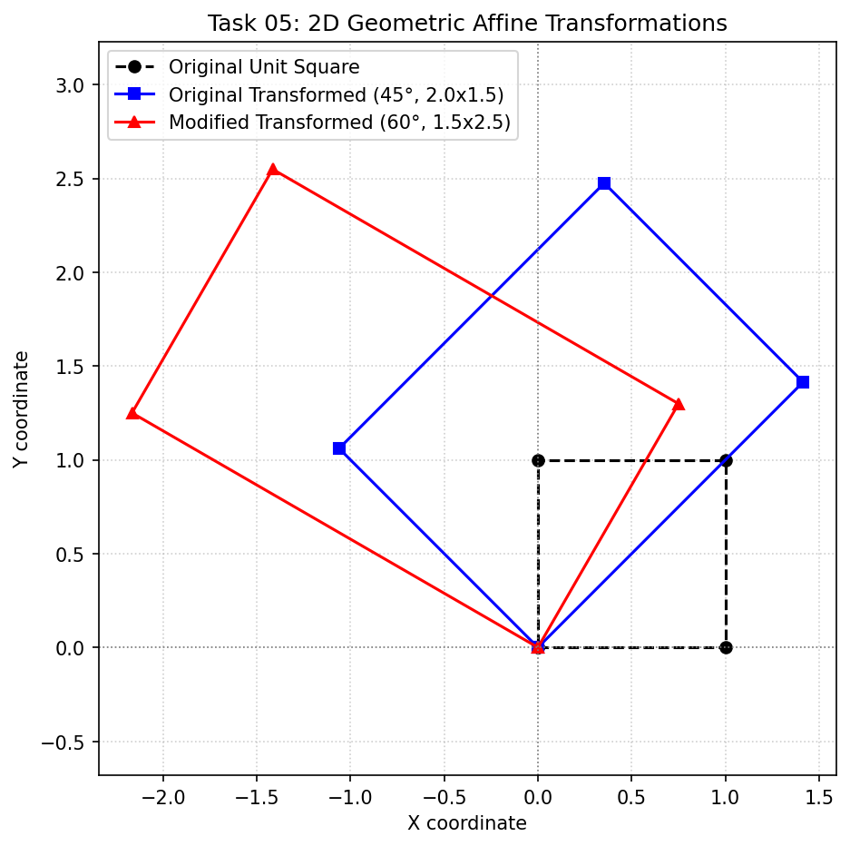
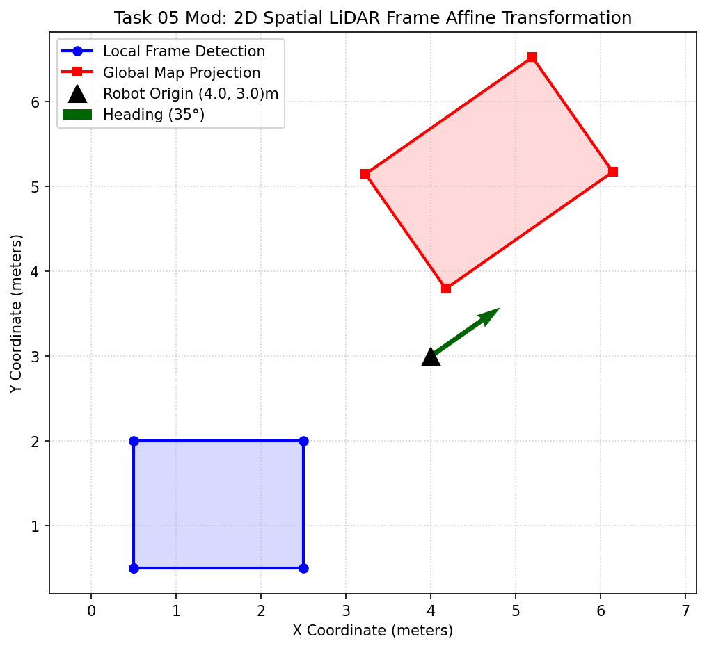

# Task 05: Matrix Algebra and Matrix Operations

## B. Input Values & Mathematical Operation
- **Mathematical Concept:** Linear affine transformations, composite matrix multiplication, row-vector transformations, and geometric scaling quantified by the matrix determinant.
- **Input Values:**
  - Vertices of a 2D unit square:
    $$P = \begin{bmatrix} 0.0 & 0.0 \\ 1.0 & 0.0 \\ 1.0 & 1.0 \\ 0.0 & 1.0 \end{bmatrix}$$
  - Counter-clockwise rotation angle: $\theta = 45^\circ$ ($\frac{\pi}{4}\text{ rad}$).
  - Scale factors: $S_x = 2.0, S_y = 1.5$.
- **Mathematical Operations:**
  - Rotation Matrix:
    $$R = \begin{bmatrix} \cos\theta & -\sin\theta \\ \sin\theta & \cos\theta \end{bmatrix} = \begin{bmatrix} \frac{\sqrt{2}}{2} & -\frac{\sqrt{2}}{2} \\ \frac{\sqrt{2}}{2} & \frac{\sqrt{2}}{2} \end{bmatrix}$$
  - Scaling Matrix:
    $$S = \begin{bmatrix} 2.0 & 0.0 \\ 0.0 & 1.5 \end{bmatrix}$$
  - Combined Matrix: $M = R \cdot S$
  - Row-vector coordinate transformation: $P_{\text{transformed}} = P \cdot M^T$
  - Determinant: $\det(M) = \det(R)\det(S) = 1.0 \cdot (2.0 \times 1.5) = 3.0$

## C. Parameter Modification & Result Change
- **Parameter Modified:** Altered rotation angle to $\theta = 60^\circ$ and non-uniform scaling matrix to $S_{\text{mod}} = \begin{bmatrix} 1.5 & 0.0 \\ 0.0 & 2.5 \end{bmatrix}$.
- **Quantitative Result Comparison:**
  | Metric | Original Setup ($45^\circ, 2.0\times 1.5$) | Modified Setup ($60^\circ, 1.5\times 2.5$) | Relative Impact |
  | :--- | :--- | :--- | :--- |
  | **Composite Matrix $M$** | $\begin{bmatrix} 1.414 & -1.061 \\ 1.414 & 1.061 \end{bmatrix}$ | $\begin{bmatrix} 0.750 & -2.165 \\ 1.299 & 1.250 \end{bmatrix}$ | Rotated orientation by $+15^\circ$ |
  | **Determinant $\det(M)$** | $3.0000$ | $3.7500$ | Area magnified by $25\%$ |
  | **Transformed Corner $(1,1)$** | $(0.354, 2.475)$ | $(-1.415, 2.549)$ | Shifted into left upper quadrant |

## D. Output & Graph Interpretation
- Matrix multiplication order is non-commutative ($R \cdot S \ne S \cdot R$). The determinant indicates the geometric scaling ratio of the shape's enclosed surface area: a unit square of area $1.0$ is mapped into a parallelogram with area equal to $|\det(M)| = 3.0$ units.
- **Original & Comparative Visualization:**
  

---

## E. Modified Real-World Case
- **Script:** [`modified_cases/Task_05_mod.py`](../modified_cases/Task_05_mod.py)
- **Problem Statement:** An autonomous mobile robot (AGV) in a smart warehouse senses local obstacles via 2D planar LiDAR. To integrate obstacles into the static global warehouse grid, local obstacle boundary points must undergo coordinate transformation incorporating robot heading ($\theta = 35^\circ$), acoustic sensor calibration scaling ($S_x=1.2, S_y=1.1$), and global translation offset $\mathbf{t} = [4.0, 3.0]\text{ m}$.
- **New Assumptions & Inputs:**
  - Pallet container corners in body frame: $(0.5, 0.5), (2.5, 0.5), (2.5, 2.0), (0.5, 2.0)$ [meters].
  - Heading: $\theta = 35^\circ$, Scaling factors: $[1.2, 1.1]$, Translation: $[4.0, 3.0]\text{ m}$.
  - Transformation: $P_{\text{global}} = P_{\text{local}} \cdot (R \cdot S)^T + \mathbf{t}$.
- **Output Results:**
  - Determinant (Sensor Area Dilation): $\det(M) = 1.3200$.
  - Global Obstacle Coordinates:
    - Corner 1: $(4.18, 3.79)\text{ m}$
    - Corner 2: $(6.14, 5.17)\text{ m}$
    - Corner 3: $(5.20, 6.52)\text{ m}$
    - Corner 4: $(3.23, 5.15)\text{ m}$
- **Interpretation:** The affine transformation rotates, scales, and offsets the detected pallet boundaries into world coordinates, allowing the robot's navigation stack to avoid collisions.
- **Modified Case Visualization:**
  
