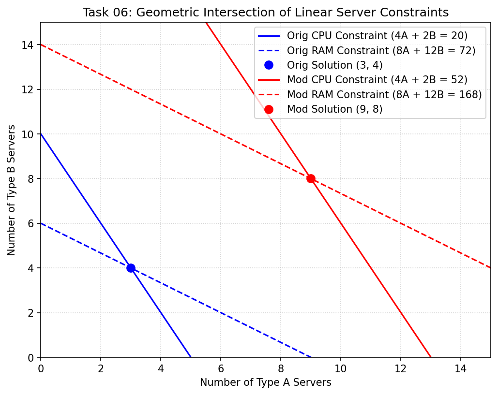
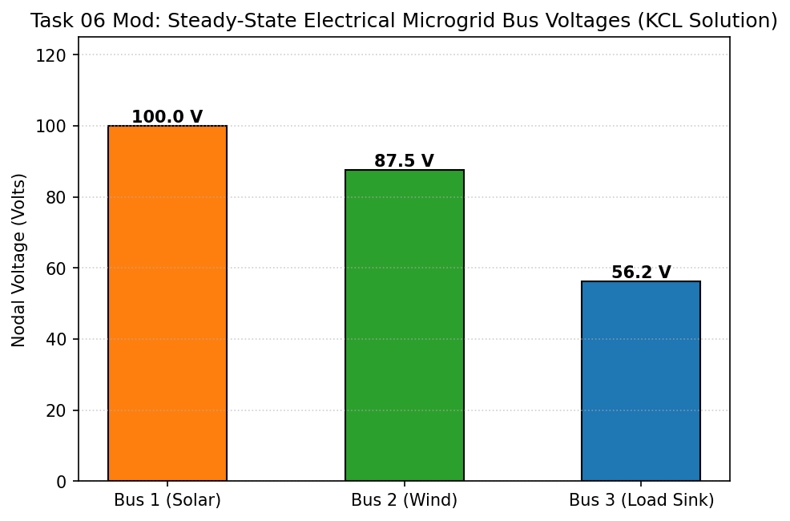

# Task 06: Solution of Systems of Linear Equations

## B. Input Values & Mathematical Operation
- **Mathematical Concept:** Systems of simultaneous linear algebraic equations $A \mathbf{x} = \mathbf{b}$, condition number, direct matrix factorization, and residual vector norm analysis $||\mathbf{b} - A\mathbf{x}||_2$.
- **Input Values:**
  - Resource consumption matrix $A$ (CPU cores and RAM GB per server type):
    $$A = \begin{bmatrix} 4.0 & 2.0 \\ 8.0 & 12.0 \end{bmatrix}$$
  - Observed total resource usage vector $\mathbf{b} = \begin{bmatrix} 20.0 \\ 72.0 \end{bmatrix}$
- **Mathematical Operations:**
  - Solve for active servers: $\mathbf{x} = A^{-1} \mathbf{b}$ via `np.linalg.solve(A, b)`.
  - Residual calculation: $\mathbf{r} = \mathbf{b} - A \mathbf{x}$.
  - Residual norm: $||\mathbf{r}||_2 = \sqrt{r_1^2 + r_2^2}$.

## C. Parameter Modification & Result Change
- **Parameter Modified:** High-demand server workload: Total observed resource usage scaled to $\mathbf{b}_{\text{mod}} = \begin{bmatrix} 52.0 \\ 168.0 \end{bmatrix}$ (representing an enterprise workload surge).
- **Quantitative Result Comparison:**
  | Metric | Original Scenario | Modified Workload Surge | Absolute Increase |
  | :--- | :--- | :--- | :--- |
  | **CPU Target** | $20.0\text{ cores}$ | $52.0\text{ cores}$ | $+32.0\text{ cores}$ |
  | **RAM Target** | $72.0\text{ GB}$ | $168.0\text{ GB}$ | $+96.0\text{ GB}$ |
  | **Type A Servers ($x_1$)** | $\mathbf{3}$ servers | $\mathbf{9}$ servers | $+6$ servers |
  | **Type B Servers ($x_2$)** | $\mathbf{4}$ servers | $\mathbf{8}$ servers | $+4$ servers |
  | **Residual Norm $||\mathbf{r}||_2$** | $0.000 \times 10^0$ | $0.000 \times 10^0$ | Machine exact ($0.0$) |

## D. Output & Graph Interpretation
- The system of linear equations geometrically represents the intersection of two straight lines in 2D space: the CPU constraint and the Memory constraint. The unique intersection point $(3, 4)$ simultaneously satisfies both resource allocations with zero residual norm.
- **Original & Comparative Visualization:**
  

---

## E. Modified Real-World Case
- **Script:** [`modified_cases/Task_06_mod.py`](../modified_cases/Task_06_mod.py)
- **Problem Statement:** An electrical microgrid with three interconnected bus bars receives current injections from renewable sources and supplies industrial load sinks. In accordance with Kirchhoff's Current Law (KCL), the system satisfies $G \mathbf{v} = \mathbf{i}$, where $G$ is the $3 \times 3$ nodal conductance matrix (Siemens), $\mathbf{v}$ is the unknown nodal voltage vector (Volts), and $\mathbf{i}$ is the net current injection vector (Amperes).
- **New Assumptions & Inputs:**
  - Conductance matrix $G = \begin{bmatrix} 0.8 & -0.5 & -0.2 \\ -0.5 & 1.0 & -0.4 \\ -0.2 & -0.4 & 0.8 \end{bmatrix}\text{ Siemens}$.
  - Current injection vector $\mathbf{i} = [25.0, 15.0, -10.0]^T\text{ Amperes}$.
- **Output Results:**
  - Solved Bus 1 Voltage: $V_1 = 100.00\text{ V}$
  - Solved Bus 2 Voltage: $V_2 = 87.50\text{ V}$
  - Solved Bus 3 Voltage: $V_3 = 56.25\text{ V}$
  - Verification: $G \mathbf{v} = [25.0, 15.0, -10.0]^T$
  - Residual L2 Norm: $7.536 \times 10^{-15}\text{ A}$
- **Interpretation:** The solved bus voltages respect physical potential gradients: current flows from higher potential Bus 1 ($100\text{ V}$) and Bus 2 ($87.5\text{ V}$) into the negative load sink Bus 3 ($56.25\text{ V}$). The residual norm confirms double-precision numerical accuracy.
- **Modified Case Visualization:**
  
