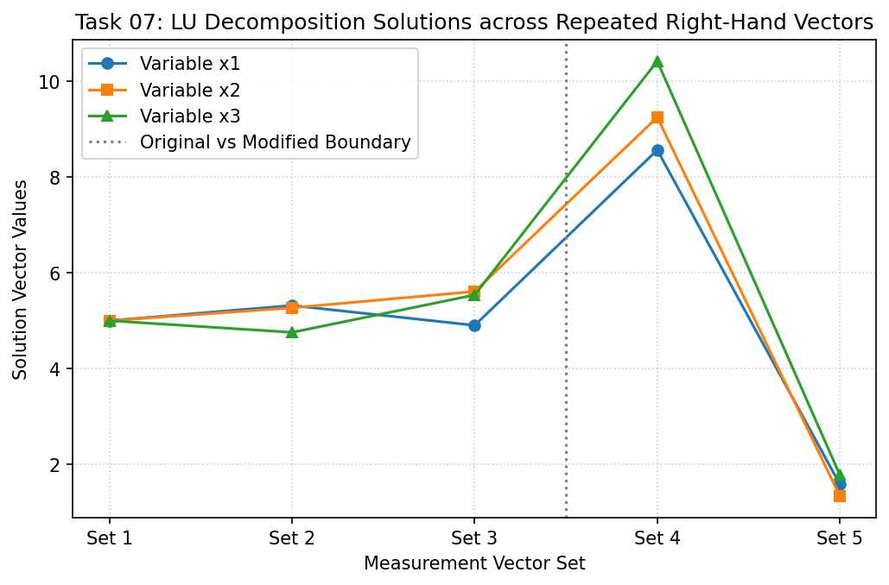
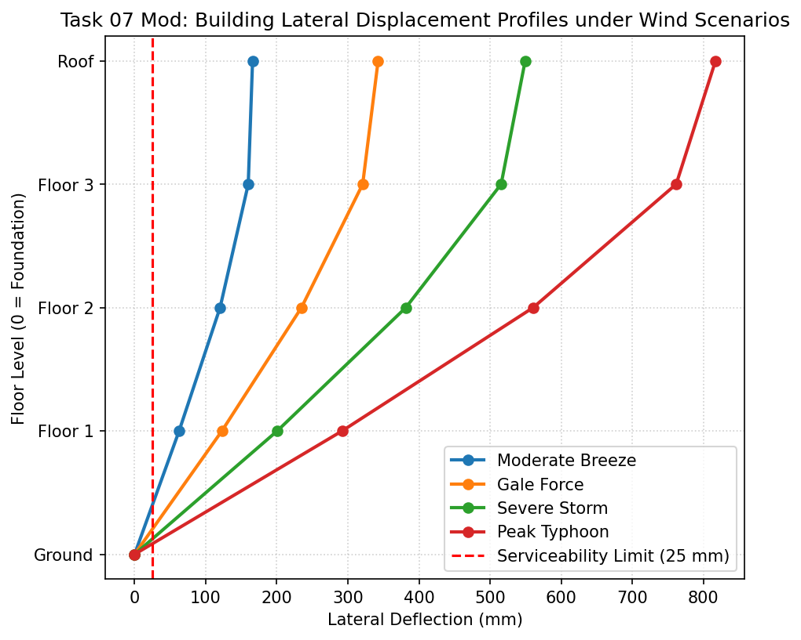

# Task 07: Gaussian Elimination and LU Decomposition

## B. Input Values & Mathematical Operation
- **Mathematical Concept:** LU Factorization with partial row pivoting ($P A = L U$). The square matrix $A$ is factored once into lower-triangular matrix $L$ and upper-triangular matrix $U$. Subsequent linear systems $A \mathbf{x} = \mathbf{b}_k$ are resolved via forward-substitution ($L \mathbf{y} = P \mathbf{b}_k$) and back-substitution ($U \mathbf{x} = \mathbf{y}$) in $O(n^2)$ time instead of full $O(n^3)$ Gaussian elimination.
- **Input Values:**
  - Coefficient matrix:
    $$A = \begin{bmatrix} 4.0 & -1.0 & 0.0 \\ -1.0 & 4.0 & -1.0 \\ 0.0 & -1.0 & 3.0 \end{bmatrix}$$
  - Measurement vectors $\mathbf{b}_1 = [15, 10, 10]^T$, $\mathbf{b}_2 = [16, 11, 9]^T$, $\mathbf{b}_3 = [14, 12, 11]^T$.
- **Mathematical Operations:**
  - `lu, piv = scipy.linalg.lu_factor(A)`
  - `x = scipy.linalg.lu_solve((lu, piv), b)`
  - Residual norm: $||\mathbf{b} - A \mathbf{x}||_2$.

## C. Parameter Modification & Result Change
- **Parameter Modified:** Appended two boundary condition load cases: $\mathbf{b}_4 = [25.0, 18.0, 22.0]^T$ (heavy load) and $\mathbf{b}_5 = [5.0, 2.0, 4.0]^T$ (light load).
- **Quantitative Result Comparison:**
  | Load Case $\mathbf{b}$ | Solution Vector $\mathbf{x} = [x_1, x_2, x_3]$ | Residual Norm $||\mathbf{r}||_2$ | Computational Reuse |
  | :--- | :--- | :--- | :--- |
  | **Set 1: $[15, 10, 10]$** | $[5.0000, 5.0000, 5.0000]$ | $0.000 \times 10^0$ | Factored $A$ once |
  | **Set 2: $[16, 11, 9]$** | $[5.3171, 5.2683, 4.7561]$ | $1.776 \times 10^{-15}$ | $O(n^2)$ back-sub |
  | **Set 3: $[14, 12, 11]$** | $[4.9024, 5.6098, 5.5366]$ | $0.000 \times 10^0$ | $O(n^2)$ back-sub |
  | **Mod Set 4: $[25, 18, 22]$** | $[8.5610, 9.2439, 10.4146]$ | $3.553 \times 10^{-15}$ | $O(n^2)$ back-sub |
  | **Mod Set 5: $[5, 2, 4]$** | $[1.5854, 1.3415, 1.7805]$ | $6.661 \times 10^{-16}$ | $O(n^2)$ back-sub |

## D. Output & Graph Interpretation
- Reusing the pre-factored LU representation delivers exact numerical agreement with direct Gaussian elimination (`np.linalg.solve`), but with significant computational efficiency when processing repetitive real-time telemetry frames. The state variables track linear responses directly proportional to the applied excitation vectors.
- **Original & Comparative Visualization:**
  

---

## E. Modified Real-World Case
- **Script:** [`modified_cases/Task_07_mod.py`](../modified_cases/Task_07_mod.py)
- **Problem Statement:** In civil structural engineering, a 4-story building shear frame is subject to fluctuating wind storm conditions. The building's structural stiffness matrix $K$ ($4 \times 4$ in kN/m) remains constant over time, while wind pressure profiles $\mathbf{F}$ vary across meteorological load categories: Moderate Sea Breeze, Gale Force, Severe Storm, and Peak Typhoon Gust. LU decomposition avoids refactorizing the stiffness matrix for each storm gust.
- **New Assumptions & Inputs:**
  - Frame stiffness matrix $K = \begin{bmatrix} 1200 & -500 & 0 & 0 \\ -500 & 1000 & -400 & 0 \\ 0 & -400 & 800 & -300 \\ 0 & 0 & -300 & 500 \end{bmatrix}\text{ kN/m}$.
  - Wind vectors: Breeze $[15, 25, 30, 35]\text{ kN}$, Gale $[30, 45, 60, 75]\text{ kN}$, Storm $[50, 75, 95, 120]\text{ kN}$, Typhoon $[70, 110, 140, 180]\text{ kN}$.
- **Output Results:**
  - Maximum Roof Deflection:
    - Moderate Breeze: $165.89\text{ mm}$
    - Gale Force: $342.47\text{ mm}$
    - Severe Storm: $549.29\text{ mm}$
    - Peak Typhoon Gust: $817.03\text{ mm}$
  - Residual Norms: all $\le 6.355 \times 10^{-14}\text{ kN}$.
- **Interpretation:** As wind intensity progresses from moderate breeze to peak typhoon, structural floor drift scales proportionally. The peak typhoon roof deflection ($817\text{ mm}$) exceeds typical structural serviceability limits ($25\text{ mm}$), confirming the need for tuned mass dampers.
- **Modified Case Visualization:**
  
