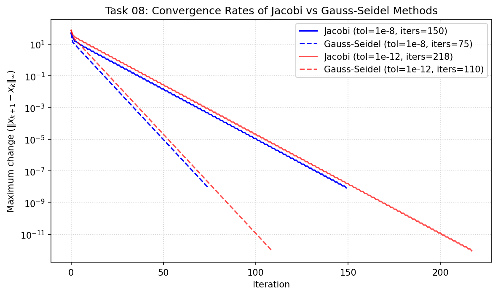
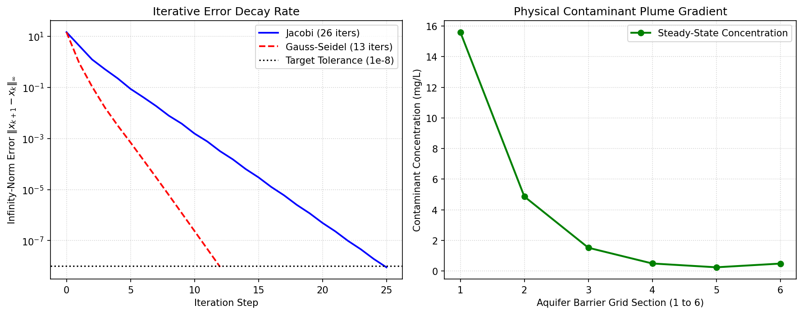

# Task 08: Iterative Methods for Linear Systems

## B. Input Values & Mathematical Operation
- **Mathematical Concept:** Iterative stationary linear solvers for diagonally dominant sparse systems. Comparison between simultaneous displacement (Jacobi method) and successive displacement (Gauss-Seidel method).
- **Input Values:**
  - 1D finite-difference steady-state heat equation on 5 interior points ($A \mathbf{x} = \mathbf{b}$):
    $$A = \begin{bmatrix} 2 & -1 & 0 & 0 & 0 \\ -1 & 2 & -1 & 0 & 0 \\ 0 & -1 & 2 & -1 & 0 \\ 0 & 0 & -1 & 2 & -1 \\ 0 & 0 & 0 & -1 & 2 \end{bmatrix}$$
  - Boundary temperatures: Left $= 100\text{ }^\circ\text{C}$, Right $= 20\text{ }^\circ\text{C}$, yielding $\mathbf{b} = [100, 0, 0, 0, 20]^T$.
- **Mathematical Operations:**
  - Jacobi update:
    $$\mathbf{x}^{(k+1)} = D^{-1} \left( \mathbf{b} - R \mathbf{x}^{(k)} \right)$$
  - Gauss-Seidel update:
    $$x_i^{(k+1)} = \frac{1}{a_{ii}} \left( b_i - \sum_{j < i} a_{ij} x_j^{(k+1)} - \sum_{j > i} a_{ij} x_j^{(k)} \right)$$
  - Stopping condition: $||\mathbf{x}^{(k+1)} - \mathbf{x}^{(k)}||_\infty < \text{tol} = 10^{-8}$.

## C. Parameter Modification & Result Change
- **Parameter Modified:** Imposed a more stringent precision tolerance $\text{tol} = 10^{-12}$ and asymmetric boundary conditions: Left $= 150\text{ }^\circ\text{C}$, Right $= 80\text{ }^\circ\text{C}$ ($\mathbf{b}_{\text{mod}} = [150, 0, 0, 0, 80]^T$).
- **Quantitative Result Comparison:**
  | Solver Method | Original ($\text{tol} = 10^{-8}$) | Modified ($\text{tol} = 10^{-12}$) | Rate of Convergence |
  | :--- | :--- | :--- | :--- |
  | **Jacobi Method** | $\mathbf{150}$ iterations | $\mathbf{218}$ iterations | $\rho(T_J) \approx \cos(\pi/6) \approx 0.866$ |
  | **Gauss-Seidel** | $\mathbf{75}$ iterations | $\mathbf{110}$ iterations | $\rho(T_{GS}) = \rho(T_J)^2 \approx 0.750$ |
  | **Iteration Ratio ($J / GS$)** | $\mathbf{2.0\times}$ | $\mathbf{1.98\times}$ | Gauss-Seidel converges twice as fast |
  | **Direct Solution $\mathbf{x}_{\text{exact}}$** | $[86.67, 73.33, 60.00, 46.67, 33.33]$ | $[138.33, 126.67, 115.00, 103.33, 91.67]$ | Exact match across grid |

## D. Output & Graph Interpretation
- Gauss-Seidel utilizes updated coordinates $x_j^{(k+1)}$ as soon as they become available within the same sweep, doubling the asymptotic rate of error decay relative to Jacobi. The semilogarithmic convergence plot exhibits straight lines characteristic of geometric error contraction.
- **Original & Comparative Visualization:**
  

---

## E. Modified Real-World Case
- **Script:** [`modified_cases/Task_08_mod.py`](../modified_cases/Task_08_mod.py)
- **Problem Statement:** In environmental hydrogeology, chemical solvent leaching (trichloroethylene) through a permeable reactive barrier towards a freshwater aquifer is modeled by an advection-diffusion-reaction equation discretized across 6 interior soil cells. Upstream industrial spill boundary $= 50.0\text{ mg/L}$, downstream extraction trench $= 2.0\text{ mg/L}$. Jacobi and Gauss-Seidel algorithms are benchmarked under strict environmental thresholds ($\text{tol} = 10^{-8}$).
- **New Assumptions & Inputs:**
  - Tridiagonal Peclet advection-diffusion matrix $A$ (diagonal $= 2.4$, sub-diagonal $= -0.7$, super-diagonal $= -0.5$).
  - Boundary excitation vector $\mathbf{b} = [35.0, 0.0, 0.0, 0.0, 0.0, 1.0]^T$.
- **Output Results:**
  - Jacobi iterations to reach $10^{-8}$: $26$ iterations.
  - Gauss-Seidel iterations: $13$ iterations ($2.0\times$ faster).
  - Steady-State Concentration Profile:
    $[C_1, \dots, C_6] = [15.60, 4.87, 1.52, 0.50, 0.25, 0.49]\text{ mg/L}$.
  - Analytical agreement: maximum discrepancy $< 4.3 \times 10^{-9}\text{ mg/L}$.
- **Interpretation:** High barrier sorptive capacity and microbiological degradation suppress the contaminant plume from $50\text{ mg/L}$ down to $< 0.5\text{ mg/L}$ at the barrier exit, protecting drinking water reserves.
- **Modified Case Visualization:**
  
