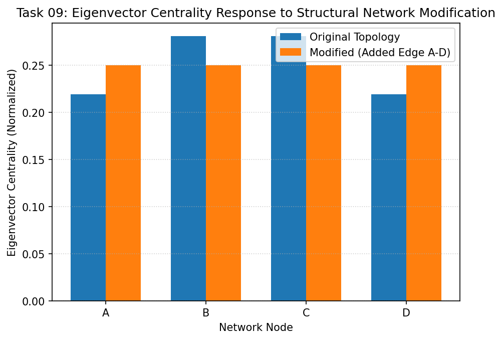
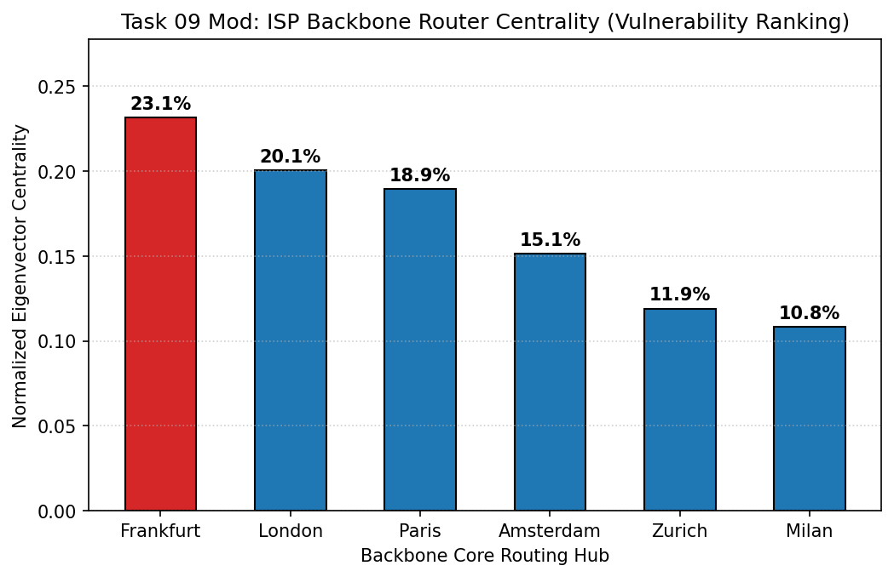

# Task 09: Eigenvalues and Eigenvectors

## B. Input Values & Mathematical Operation
- **Mathematical Concept:** Spectral graph theory, characteristic polynomial roots $\det(A - \lambda I) = 0$, dominant eigenvalue (spectral radius), and eigenvector centrality (Perron-Frobenius theorem).
- **Input Values:**
  - Adjacency matrix of an undirected 4-node network ($A, B, C, D$):
    $$A = \begin{bmatrix} 0 & 1 & 1 & 0 \\ 1 & 0 & 1 & 1 \\ 1 & 1 & 0 & 1 \\ 0 & 1 & 1 & 0 \end{bmatrix}$$
- **Mathematical Operations:**
  - Eigendecomposition: $A \mathbf{v} = \lambda \mathbf{v}$ via `np.linalg.eig(A)`.
  - Dominant eigenvalue: $\lambda_{\max} = \max_i |\lambda_i|$.
  - Normalized eigenvector centrality: $\mathbf{c} = \frac{|\mathbf{v}_{\text{dom}}|}{\sum_j |v_{\text{dom},j}|}$.
  - Verification error: $||A \mathbf{v} - \lambda_{\max}\mathbf{v}||_2$.

## C. Parameter Modification & Result Change
- **Parameter Modified:** Added a bridging edge between outer nodes $A$ and $D$ ($A_{03} = A_{30} = 1.0$), transforming the graph into a fully symmetric 4-node complete ring with cross-chords ($K_4$ minus two diagonals replaced).
- **Quantitative Result Comparison:**
  | Metric | Original Topology | Modified Topology (Edge A-D Added) | Structural Impact |
  | :--- | :--- | :--- | :--- |
  | **Dominant Eigenvalue $\lambda_{\max}$** | $2.5616$ | $\mathbf{3.0000}$ | Increased overall network connectivity |
  | **Node A Centrality** | $0.2192$ ($21.9\%$) | $\mathbf{0.2500}$ ($25.0\%$) | $+3.1\%$ relative prominence |
  | **Node B Centrality** | $0.2808$ ($28.1\%$) | $\mathbf{0.2500}$ ($25.0\%$) | $-3.1\%$ relative prominence |
  | **Node C Centrality** | $0.2808$ ($28.1\%$) | $\mathbf{0.2500}$ ($25.0\%$) | $-3.1\%$ relative prominence |
  | **Node D Centrality** | $0.2192$ ($21.9\%$) | $\mathbf{0.2500}$ ($25.0\%$) | $+3.1\%$ relative prominence |
  | **Verification Error** | $2.69 \times 10^{-15}$ | $0.00 \times 10^0$ | Exact numerical precision |

## D. Output & Graph Interpretation
- In the original topology, nodes B and C each possess 3 connections, making them central transit hubs, while nodes A and D possess only 2 connections. Adding the direct link between A and D restores 3-regular symmetry across all four vertices, resulting in an exact uniform distribution of eigenvector centrality ($0.25$ each) and raising $\lambda_{\max}$ from $2.56$ to the regular degree $k=3$.
- **Original & Comparative Visualization:**
  

---

## E. Modified Real-World Case
- **Script:** [`modified_cases/Task_09_mod.py`](../modified_cases/Task_09_mod.py)
- **Problem Statement:** A regional Tier-1 Internet Service Provider (ISP) operates an Autonomous System (AS) network linking 6 core routing locations: Frankfurt, London, Amsterdam, Paris, Zurich, and Milan. Network engineers must quantify transit vulnerability and identify the single point of failure (critical backbone routing hub) using eigenvector centrality.
- **New Assumptions & Inputs:**
  - $6 \times 6$ symmetric adjacency matrix representing high-capacity optical transit channels.
  - Node order: [Frankfurt, London, Amsterdam, Paris, Zurich, Milan].
- **Output Results:**
  - Dominant Spectral Radius $\lambda_{\max} = 2.8529$.
  - Eigenvector Centrality Ranking:
    1. **Frankfurt**: $0.2315$ ($23.15\%$) - Highest transit influence.
    2. **London**: $0.2006$ ($20.06\%$) - Secondary core hub.
    3. **Paris**: $0.1893$ ($18.93\%$).
    4. **Amsterdam**: $0.1515$ ($15.15\%$).
    5. **Zurich**: $0.1190$ ($11.90\%$).
    6. **Milan**: $0.1081$ ($10.81\%$).
  - Spectral verification error: $2.415 \times 10^{-15}$.
- **Interpretation:** Frankfurt emerges as the most influential routing junction due to its immediate optical interconnections with London, Amsterdam, Paris, and Zurich. Disruptions in Frankfurt would generate the greatest cascading impact on network connectivity across Europe.
- **Modified Case Visualization:**
  
