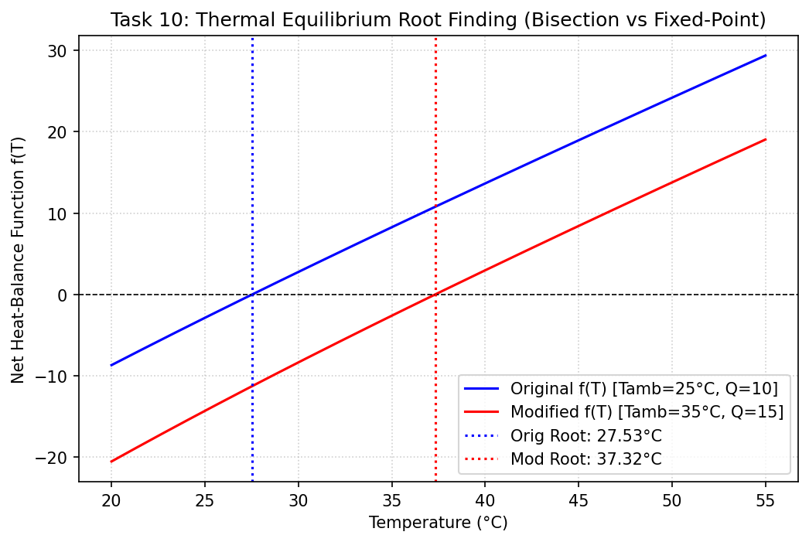
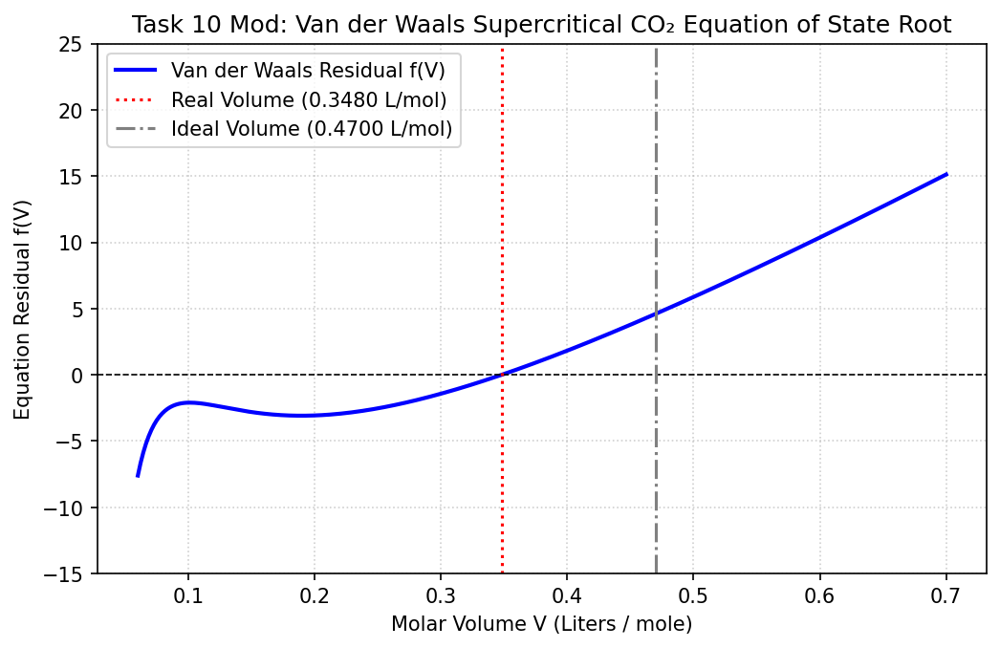

# Task 10: Root Finding: Bisection and Fixed-Point Methods

## B. Input Values & Mathematical Operation
- **Mathematical Concept:** Nonlinear scalar root finding $f(T) = 0$ via bracketed interval bisection and contraction fixed-point iteration $T_{k+1} = g(T_k)$.
- **Input Values:**
  - Nonlinear heat-balance equation:
    $$f(T) = T - 25 - 10 e^{-T / 20} = 0$$
  - Bisection initial bracket: $[a, b] = [20.0, 40.0]\text{ }^\circ\text{C}$.
  - Fixed-point iteration function:
    $$g(T) = 25 + 10 e^{-T / 20}$$
  - Initial guess $T_0 = 30.0\text{ }^\circ\text{C}$, precision tolerance $\text{xtol} = 10^{-10}$.
- **Mathematical Operations:**
  - Bisection method: Test sign change $f(a) \cdot f(m) < 0$ at midpoint $m = \frac{a+b}{2}$, iteratively halving interval width.
  - Fixed-point method: Compute $T_{k+1} = g(T_k)$ until $|T_{k+1} - T_k| < 10^{-10}$.

## C. Parameter Modification & Result Change
- **Parameter Modified:** Elevated ambient temperature to $35.0\text{ }^\circ\text{C}$ and increased heat generation magnitude to $15.0$:
  $$f_{\text{mod}}(T) = T - 35 - 15 e^{-T / 20} = 0, \quad g_{\text{mod}}(T) = 35 + 15 e^{-T / 20}$$
- **Quantitative Result Comparison:**
  | Metric | Original Parameters ($T_{\text{amb}}=25, Q=10$) | Modified Parameters ($T_{\text{amb}}=35, Q=15$) | Physical Shift |
  | :--- | :--- | :--- | :--- |
  | **Bisection Root** | $27.525211\text{ }^\circ\text{C}$ | $37.321004\text{ }^\circ\text{C}$ | $+9.795793\text{ }^\circ\text{C}$ |
  | **Fixed-Point Root** | $27.525211\text{ }^\circ\text{C}$ | $37.321004\text{ }^\circ\text{C}$ | Agreement to $10^{-10}$ |
  | **Fixed-Point Iterations** | $\mathbf{13}$ iterations | $\mathbf{13}$ iterations | Stable contraction rate |
  | **Contraction Factor $|g'(T^*)|$** | $|-\frac{10}{20} e^{-27.53/20}| \approx 0.126$ | $|-\frac{15}{20} e^{-37.32/20}| \approx 0.116$ | Both satisfy $|g'| < 1$ |

## D. Output & Graph Interpretation
- Because $|g'(T)| \ll 1$ in the vicinity of the root, the Banach fixed-point theorem guarantees rapid, monotonic convergence. Bisection guarantees robustness without derivative requirements, while fixed-point iteration reaches $10^{-10}$ precision within just 13 steps.
- **Original & Comparative Visualization:**
  

---

## E. Modified Real-World Case
- **Script:** [`modified_cases/Task_10_mod.py`](../modified_cases/Task_10_mod.py)
- **Problem Statement:** In petrochemical reactor design, Carbon Dioxide ($CO_2$) is pressurized into a supercritical fluid at $P = 55.0\text{ atm}$ and $T = 315.0\text{ K}$. At this state, ideal gas assumptions fail drastically. The Van der Waals equation of state is solved for real molar volume $V$ ($\text{L/mol}$):
  $$f(V) = \left(P + \frac{a}{V^2}\right)(V - b) - RT = 0$$
  and fixed-point iteration: $V_{k+1} = b + \frac{RT}{P + a / V_k^2}$.
- **New Assumptions & Inputs:**
  - $CO_2$ constants: $a = 3.592\text{ L}^2\text{atm/mol}^2, b = 0.04267\text{ L/mol}, R = 0.082057\text{ L}\cdot\text{atm/(mol}\cdot\text{K)}$.
  - Conditions: $P = 55.0\text{ atm}, T = 315.0\text{ K}$.
  - Ideal Gas Volume: $V_{\text{ideal}} = \frac{RT}{P} = 0.469963\text{ L/mol}$.
- **Output Results:**
  - Bisection Root: $V^* = 0.347956\text{ L/mol}$ (34 iterations).
  - Fixed-Point Root: $V^* = 0.347956\text{ L/mol}$ (41 iterations).
  - Real Gas Compressibility Factor: $Z = \frac{P V^*}{RT} = \mathbf{0.7404}$.
- **Interpretation:** The real molar volume ($0.348\text{ L/mol}$) is $26\%$ smaller than predicted by the ideal gas law ($0.470\text{ L/mol}$). Intermolecular attraction forces compress the gas significantly, which is critical for accurate sizing of supercritical chemical storage vessels.
- **Modified Case Visualization:**
  
