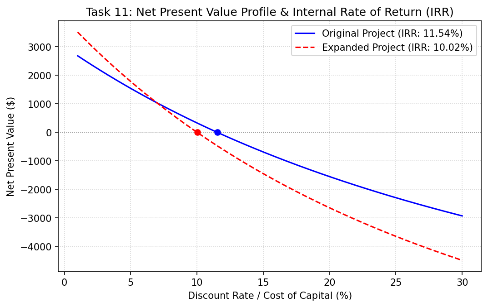
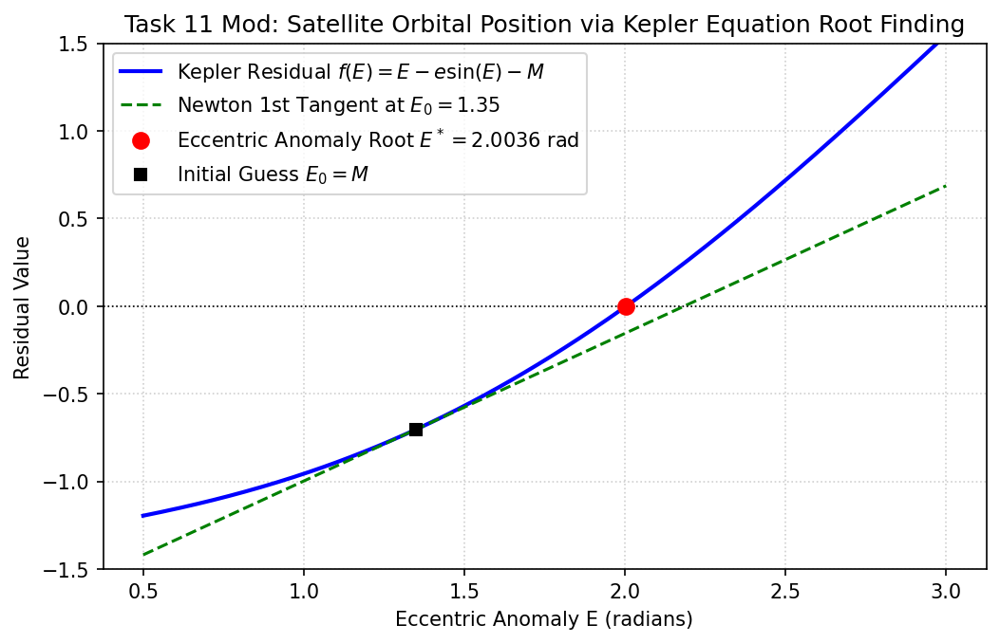

# Task 11: Root Finding: Newton-Raphson and Secant Methods

## B. Input Values & Mathematical Operation
- **Mathematical Concept:** Derivative-based open root finding using Newton-Raphson (quadratic convergence $O(\epsilon^2)$) versus finite-difference Secant method (superlinear convergence $O(\epsilon^{1.618})$).
- **Input Values:**
  - Capital budgeting cash flows:
    $$\text{cash\_flows} = [-10000, 3000, 3500, 4000, 2500]$$
- **Mathematical Operations:**
  - Net Present Value (NPV) as a function of discount rate $r$:
    $$\text{NPV}(r) = \sum_{t=0}^{4} \frac{C_t}{(1 + r)^t} = 0$$
  - Analytical first derivative:
    $$\frac{d}{dr}\text{NPV}(r) = \sum_{t=1}^{4} \frac{-t \cdot C_t}{(1 + r)^{t+1}}$$
  - Newton-Raphson update: $r_{k+1} = r_k - \frac{\text{NPV}(r_k)}{\text{NPV}'(r_k)}$
  - Secant update: $r_{k+1} = r_k - \text{NPV}(r_k)\frac{r_k - r_{k-1}}{\text{NPV}(r_k) - \text{NPV}(r_{k-1})}$

## C. Parameter Modification & Result Change
- **Parameter Modified:** Capital expansion scenario: Initial investment increased to $\$12,500$ and cash inflows extended with a 5th year return of $\$3,500$:
  $$\text{cash\_flows\_mod} = [-12500, 3000, 3500, 4000, 2500, 3500]$$
- **Quantitative Result Comparison:**
  | Metric | Original Project | Modified Capital Expansion | Difference |
  | :--- | :--- | :--- | :--- |
  | **Internal Rate of Return (IRR)** | $\mathbf{11.542461\%}$ | $\mathbf{10.018282\%}$ | $-1.524179\%$ |
  | **Newton-Raphson Iterations** | $\mathbf{4}$ iterations | $\mathbf{3}$ iterations | Rapid quadratic convergence |
  | **Secant Method Iterations** | $\mathbf{7}$ iterations | $\mathbf{7}$ iterations | Superlinear convergence |
  | **NPV at Solution** | $\$0.000000$ | $\$0.000000$ | Zero residual |

## D. Output & Graph Interpretation
- Newton-Raphson reaches machine precision ($10^{-12}$) in just 3 to 4 iterations because of the parabolic quadratic error doubling near simple roots. The Secant method avoids calculating the analytical derivative while converging within 7 iterations. The NPV profile demonstrates that both methods identify the zero-crossing discount rate.
- **Original & Comparative Visualization:**
  

---

## E. Modified Real-World Case
- **Script:** [`modified_cases/Task_11_mod.py`](../modified_cases/Task_11_mod.py)
- **Problem Statement:** In satellite orbital mechanics, a Molniya communication satellite follows an eccentric elliptical orbit ($e = 0.72$). Aerospace navigation computers must solve Kepler's transcendental equation for eccentric anomaly $E$ given mean anomaly $M = 1.35\text{ rad}$:
  $$f(E) = E - e \sin(E) - M = 0, \quad f'(E) = 1 - e \cos(E)$$
- **New Assumptions & Inputs:**
  - Orbit eccentricity $e = 0.72$, Mean anomaly $M = 1.35\text{ rad}$ ($77.35^\circ$).
  - Initial guesses: $E_0 = M$ for Newton; $E_0 = M, E_1 = M + 0.25$ for Secant.
- **Output Results:**
  - Newton-Raphson Root: $E^* = 2.0036086442\text{ rad}$ ($114.80^\circ$) in **6 iterations**.
  - Secant Root: $E^* = 2.0036086442\text{ rad}$ ($114.80^\circ$) in **7 iterations**.
  - True Anomaly ($\nu$): $2.636530\text{ rad}$ ($151.06^\circ$).
  - Function Residual: $-4.441 \times 10^{-16}$.
- **Interpretation:** The solved eccentric anomaly ($114.80^\circ$) and true anomaly ($151.06^\circ$) reveal that the satellite has traversed beyond the semi-minor axis and is decelerating towards apogee. Both root solvers deliver 10 decimal places of accuracy for orbital trajectory targeting.
- **Modified Case Visualization:**
  
