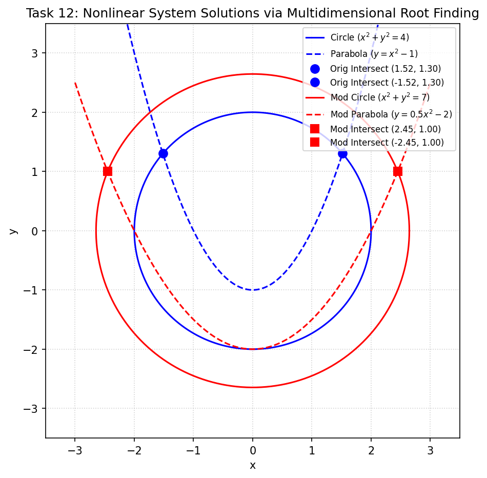
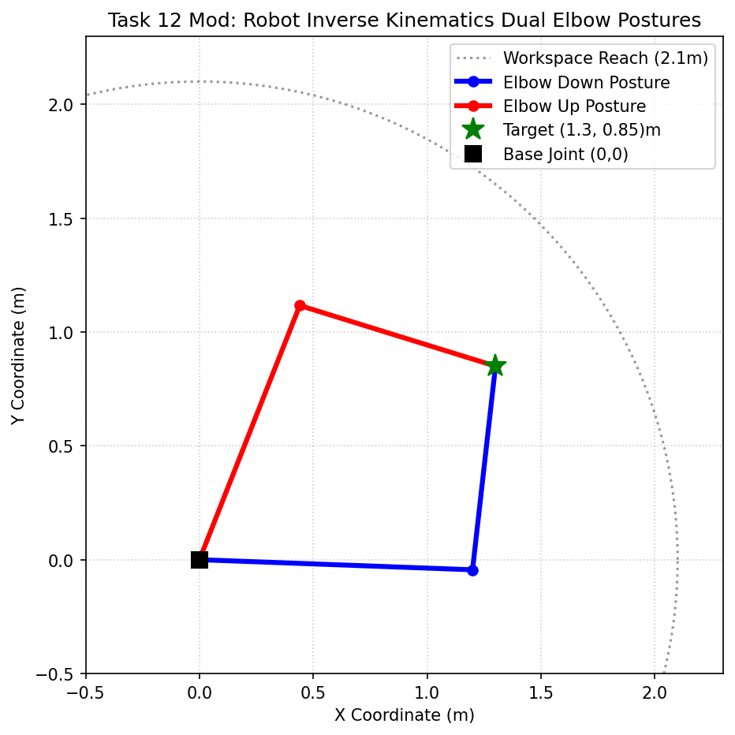

# Task 12: Polynomial and Nonlinear Equation Solving

## B. Input Values & Mathematical Operation
- **Mathematical Concept:** Multidimensional systems of coupled nonlinear algebraic equations $\mathbf{F}(\mathbf{z}) = \mathbf{0}$, vector residual minimization, and multi-point search using Powell's hybrid method (`scipy.optimize.root`).
- **Input Values:**
  - Intersection of a circle and a parabola in 2D space:
    $$f_1(x, y) = x^2 + y^2 - 4 = 0 \quad (\text{Circle of radius } r=2)$$
    $$f_2(x, y) = y - (x^2 - 1) = 0 \quad (\text{Parabola shifted down by } 1)$$
  - Initial guesses: $\mathbf{z}_{0,1} = [1.0, 1.0]$ and $\mathbf{z}_{0,2} = [-1.0, 1.0]$.
- **Mathematical Operations:**
  - Multi-variable Newton / Powell hybrid solver: $\mathbf{z}_{k+1} = \mathbf{z}_k - J^{-1}(\mathbf{z}_k)\mathbf{F}(\mathbf{z}_k)$
  - Jacobian matrix:
    $$J(x, y) = \begin{bmatrix} 2x & 2y \\ -2x & 1 \end{bmatrix}$$
  - Residual validation: $||\mathbf{F}(\mathbf{z}^*)||_2 \approx 0$.

## C. Parameter Modification & Result Change
- **Parameter Modified:** Scaled geometry to a circle of radius $R = \sqrt{7}$ ($x^2 + y^2 = 7$) and flattened parabola $y = 0.5 x^2 - 2$.
- **Quantitative Result Comparison:**
  | Geometric Feature | Original System | Modified Scaled System | Spatial Difference |
  | :--- | :--- | :--- | :--- |
  | **Circle Equation** | $x^2 + y^2 = 4$ | $x^2 + y^2 = 7$ | Enclosed area expanded from $4\pi$ to $7\pi$ |
  | **Parabola Equation** | $y = x^2 - 1$ | $y = 0.5x^2 - 2$ | Vertex shifted to $(0, -2)$, flatter curvature |
  | **Right Intersection Root** | $(\mathbf{1.5175}, \mathbf{1.3028})$ | $(\mathbf{2.4495}, \mathbf{1.0000})$ | Displaced outwards |
  | **Left Intersection Root** | $(\mathbf{-1.5175}, \mathbf{1.3028})$ | $(\mathbf{-2.4495}, \mathbf{1.0000})$ | Displaced outwards |
  | **Residual Norm** | $\le 2.48 \times 10^{-13}$ | $\le 8.88 \times 10^{-16}$ | Exact floating-point solution |

## D. Output & Graph Interpretation
- Nonlinear systems can possess multiple valid solutions, no solutions, or infinite solutions. By seeding the solver with different initial guesses in the right and left half-planes, both symmetric real intersection roots are discovered. Residual norms in the order of $10^{-13}$ to $10^{-16}$ demonstrate convergence to the true manifold intersections.
- **Original & Comparative Visualization:**
  

---

## E. Modified Real-World Case
- **Script:** [`modified_cases/Task_12_mod.py`](../modified_cases/Task_12_mod.py)
- **Problem Statement:** In industrial robotics, a 2-degree-of-freedom (2-DOF) articulated planar robotic arm ($L_1 = 1.2\text{ m}, L_2 = 0.9\text{ m}$) must position its end-effector at target coordinates $(X, Y) = (1.30, 0.85)\text{ m}$. Forward kinematics relates joint angles $(\theta_1, \theta_2)$ nonlinearly to Cartesian coordinates:
  $$L_1 \cos\theta_1 + L_2 \cos(\theta_1 + \theta_2) - X = 0$$
  $$L_1 \sin\theta_1 + L_2 \sin(\theta_1 + \theta_2) - Y = 0$$
  The controller uses `scipy.optimize.root` to discover both the "elbow-down" and "elbow-up" kinematic configurations.
- **New Assumptions & Inputs:**
  - $L_1 = 1.2\text{ m}, L_2 = 0.9\text{ m}$, Target: $(1.30, 0.85)\text{ m}$.
  - Guesses: $[0.2, 0.8]\text{ rad}$ (elbow-down) and $[0.9, -0.8]\text{ rad}$ (elbow-up).
- **Output Results:**
  - **Elbow Down Posture:** $\theta_1 = -0.0370\text{ rad}$ ($-2.12^\circ$), $\theta_2 = 1.4955\text{ rad}$ ($+85.69^\circ$).
  - **Elbow Up Posture:** $\theta_1 = 1.1951\text{ rad}$ ($+68.47^\circ$), $\theta_2 = -1.4955\text{ rad}$ ($-85.69^\circ$).
  - Achieved End-Effector: exactly $(1.3000, 0.8500)\text{ m}$.
  - Kinematic Residual Norm: $\le 3.19 \times 10^{-11}\text{ m}$.
- **Interpretation:** Both mathematical solutions reach the exact component target. The robot motion planner can select between elbow-up or elbow-down postures depending on warehouse obstacles or joint torque limits.
- **Modified Case Visualization:**
  
