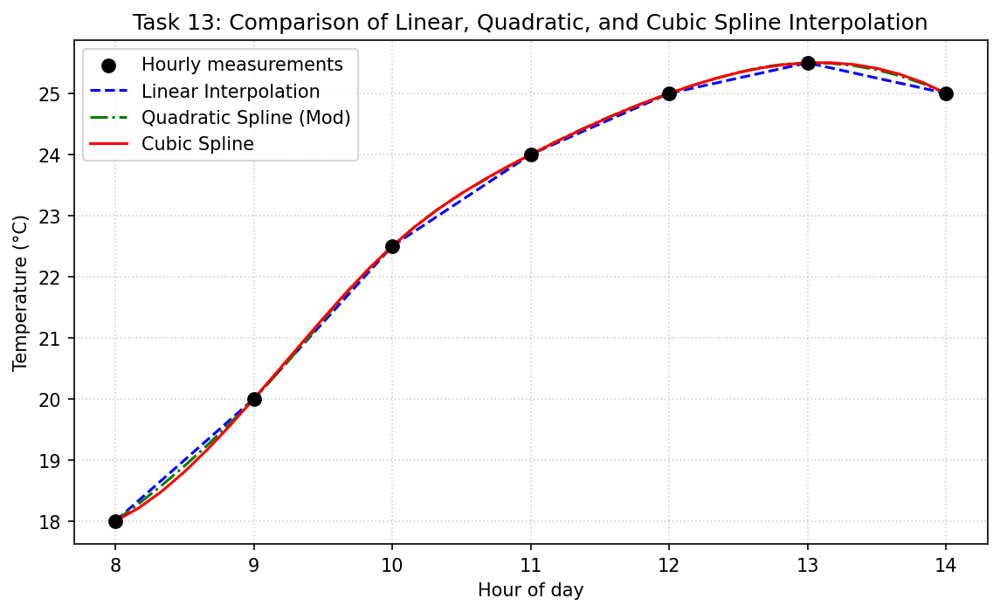
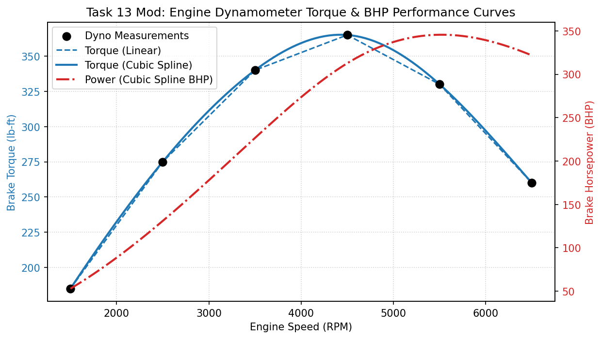

# Task 13: Interpolation

## B. Input Values & Mathematical Operation
- **Mathematical Concept:** 1D data interpolation. Comparison between piecewise linear ($C^0$ continuity) and cubic spline ($C^2$ continuous first and second derivatives) interpolation.
- **Input Values:**
  - Hourly temperature measurements recorded over 7 consecutive hours:
    $$\text{hours} = [8, 9, 10, 11, 12, 13, 14]$$
    $$\text{temperature} = [18.0, 20.0, 22.5, 24.0, 25.0, 25.5, 25.0]\text{ }^\circ\text{C}$$
  - Target interpolation timestamp: $10.5$ ($10:30\text{ AM}$).
- **Mathematical Operations:**
  - Piecewise Linear (`interp1d(kind='linear')`):
    $$S_i(x) = y_i + \frac{y_{i+1} - y_i}{x_{i+1} - x_i}(x - x_i)$$
  - Natural Cubic Spline (`CubicSpline(x, y)`):
    Piecewise 3rd-degree polynomials $S_i(x) = a_i + b_i(x - x_i) + c_i(x - x_i)^2 + d_i(x - x_i)^3$ enforcing continuity of $S(x)$, $S'(x)$, and $S''(x)$.
  - 10-minute resampled evaluation: $\Delta t = \frac{1}{6}\text{ hr}$.

## C. Parameter Modification & Result Change
- **Parameter Modified:** Added Quadratic Spline interpolation (`interp1d(kind='quadratic')`) and evaluated temperature across four distinct sub-hourly timestamps.
- **Quantitative Result Comparison:**
  | Query Timestamp | Linear Interpolation | Quadratic Spline | Cubic Spline | Spline Smoothness Gain |
  | :--- | :--- | :--- | :--- | :--- |
  | **09:15 ($t=9.25\text{h}$)** | $20.62\text{ }^\circ\text{C}$ | $20.73\text{ }^\circ\text{C}$ | $20.72\text{ }^\circ\text{C}$ | Captures concave morning rise |
  | **10:30 ($t=10.50\text{h}$)** | $\mathbf{23.25\text{ }^\circ\text{C}}$ | $\mathbf{23.31\text{ }^\circ\text{C}}$ | $\mathbf{23.33\text{ }^\circ\text{C}}$ | $+0.08\text{ }^\circ\text{C}$ curvature correction |
  | **11:45 ($t=11.75\text{h}$)** | $24.75\text{ }^\circ\text{C}$ | $24.79\text{ }^\circ\text{C}$ | $24.78\text{ }^\circ\text{C}$ | Smooth transition to peak |
  | **13:20 ($t=13.33\text{h}$)** | $25.33\text{ }^\circ\text{C}$ | $25.45\text{ }^\circ\text{C}$ | $25.47\text{ }^\circ\text{C}$ | Avoids polygonal angularities |

## D. Output & Graph Interpretation
- Linear interpolation produces discontinuous derivative slopes at sample points, leading to unphysical polygonal kinks in continuous processes. Cubic spline interpolation constructs smooth, twice-differentiable trajectories that reflect physical thermal inertia.
- **Original & Comparative Visualization:**
  

---

## E. Modified Real-World Case
- **Script:** [`modified_cases/Task_13_mod.py`](../modified_cases/Task_13_mod.py)
- **Problem Statement:** In automotive powertrain development, an engine's brake torque (lb-ft) is measured on a dynamometer at 1,000 RPM intervals between 1,500 and 6,500 RPM. The engine control unit (ECU) requires smooth torque and brake horsepower ($\text{BHP} = \frac{\tau \cdot \text{RPM}}{5252}$) interpolation across fine 50 RPM increments for ignition timing calibration.
- **New Assumptions & Inputs:**
  - Measured RPM: $[1500, 2500, 3500, 4500, 5500, 6500]$.
  - Measured Torque: $[185.0, 275.0, 340.0, 365.0, 330.0, 260.0]\text{ lb-ft}$.
  - Target evaluation: Mid-band torque at 4,000 RPM.
- **Output Results:**
  - Torque at 4,000 RPM (Linear): $352.50\text{ lb-ft}$.
  - Torque at 4,000 RPM (Cubic Spline): $359.25\text{ lb-ft}$ ($+6.75\text{ lb-ft}$ higher due to smooth torque dome curvature).
  - Peak Engine Torque: $365.16\text{ lb-ft}$ at $4,450\text{ RPM}$.
  - Peak Engine Power: $\mathbf{345.58\text{ BHP}}$ at $5,500\text{ RPM}$.
- **Interpretation:** Cubic spline interpolation captures the true turbocharger boost curve dome that linear interpolation cuts short, providing accurate horsepower and shift-point schedules for the powertrain ECU.
- **Modified Case Visualization:**
  
