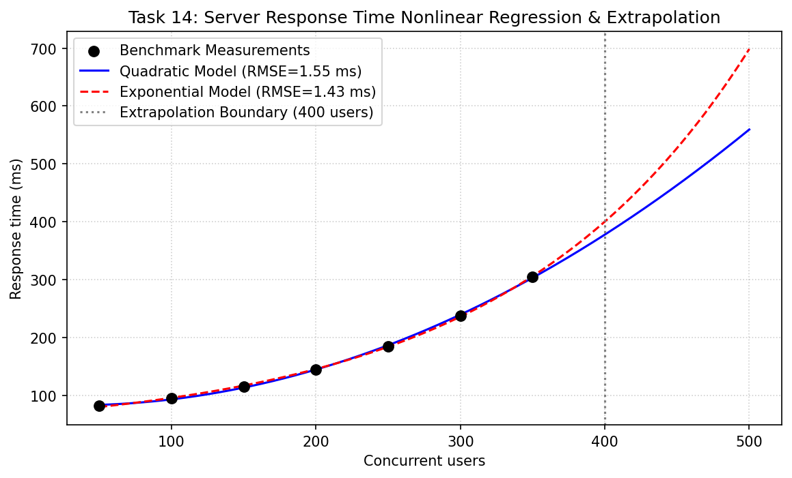
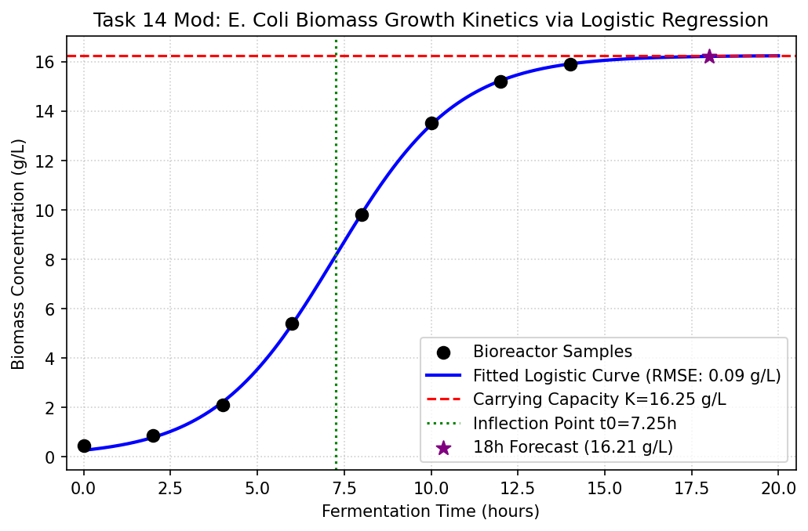

# Task 14: Curve Fitting and Approximation

## B. Input Values & Mathematical Operation
- **Mathematical Concept:** Nonlinear regression and least-squares parameter estimation minimizing the residual sum of squares:
  $$S(\mathbf{p}) = \sum_{i=1}^{N} \left( y_i - f(x_i, \mathbf{p}) \right)^2$$
- **Input Values:**
  - Concurrent active users:
    $$\text{users} = [50, 100, 150, 200, 250, 300, 350]$$
  - Measured server response time (milliseconds):
    $$\text{response\_ms} = [82, 95, 115, 145, 185, 238, 305]$$
- **Mathematical Operations:**
  - Quadratic regression model:
    $$f(x, a, b, c) = a x^2 + b x + c$$
  - Levenberg-Marquardt optimization via `scipy.optimize.curve_fit`.
  - Root Mean Square Error:
    $$\text{RMSE} = \sqrt{\frac{1}{N}\sum_{i=1}^{N} (y_i - \hat{y}_i)^2}$$
  - Extrapolation: Predict server response at $400$ users.

## C. Parameter Modification & Result Change
- **Parameter Modified:** Implemented an alternative Exponential queueing saturation model:
  $$f_{\text{exp}}(x, a_0, b_0, c_0) = a_0 e^{b_0 x} + c_0$$
  and compared fitting fidelity (RMSE) and extrapolation at $400$ and $500$ users.
- **Quantitative Result Comparison:**
  | Metric | Quadratic Model ($a x^2 + b x + c$) | Exponential Model ($a_0 e^{b_0 x} + c_0$) | Comparison |
  | :--- | :--- | :--- | :--- |
  | **Fitted Parameters** | $a=0.002167, b=-0.1345, c=85.00$ | $a_0=33.6544, b_0=0.005964, c_0=34.72$ | Nonlinear convergence |
  | **In-Sample RMSE** | $1.55\text{ ms}$ | $\mathbf{1.43\text{ ms}}$ | Exponential fits slightly tighter |
  | **Forecast at 400 Users** | $\mathbf{377.86\text{ ms}}$ | $\mathbf{400.36\text{ ms}}$ | $+22.5\text{ ms}$ higher divergence |
  | **Forecast at 500 Users** | $559.50\text{ ms}$ | $\mathbf{698.55\text{ ms}}$ | $+139.05\text{ ms}$ steep saturation |

## D. Output & Graph Interpretation
- While both models achieve low in-sample RMSE ($< 1.6\text{ ms}$), their predictions diverge significantly in the extrapolation regime ($> 350$ users). Under heavy queueing conditions, exponential models capture steep resource saturation and thread-pool exhaustion better than polynomial approximations.
- **Original & Comparative Visualization:**
  

---

## E. Modified Real-World Case
- **Script:** [`modified_cases/Task_14_mod.py`](../modified_cases/Task_14_mod.py)
- **Problem Statement:** In industrial biotechnology, recombinant E. coli is cultured in a bioreactor to synthesize pharmaceutical proteins. Biomass concentration $N(t)$ ($\text{g/L}$) is sampled across a 14-hour fermentation cycle. Microbial growth kinetics follow the nonlinear sigmoidal logistic equation:
  $$N(t) = \frac{K}{1 + e^{-r(t - t_0)}}$$
  where $K$ is the carrying capacity, $r$ is the intrinsic specific growth rate, and $t_0$ is the inflection point. SciPy's `curve_fit` estimates parameters and forecasts yield at $t = 18\text{ hr}$.
- **New Assumptions & Inputs:**
  - Fermentation times: $t = [0, 2, 4, 6, 8, 10, 12, 14]\text{ hr}$.
  - Biomass samples: $[0.45, 0.85, 2.10, 5.40, 9.80, 13.50, 15.20, 15.90]\text{ g/L}$.
  - Initial guesses: $p_0 = [16.0, 0.6, 7.0]$.
- **Output Results:**
  - Carrying Capacity $K$: $16.245 \pm 0.113\text{ g/L}$.
  - Specific Growth Rate $r$: $0.5692 \pm 0.0121\text{ hr}^{-1}$.
  - Inflection Midpoint $t_0$: $7.246 \pm 0.048\text{ hr}$.
  - Model In-Sample RMSE: $\mathbf{0.0877\text{ g/L}}$.
  - Forecast Biomass at 18h: $\mathbf{16.21\text{ g/L}}$ ($99.8\%$ saturation of carrying capacity).
- **Interpretation:** The logistic model captures the three biological phases: initial lag phase, exponential growth around $t_0 = 7.25\text{ hr}$, and stationary nutrient exhaustion asymptotically approaching $16.25\text{ g/L}$. This indicates that harvesting should occur at $t = 14\text{ hr}$ to maximize bioreactor throughput.
- **Modified Case Visualization:**
  
