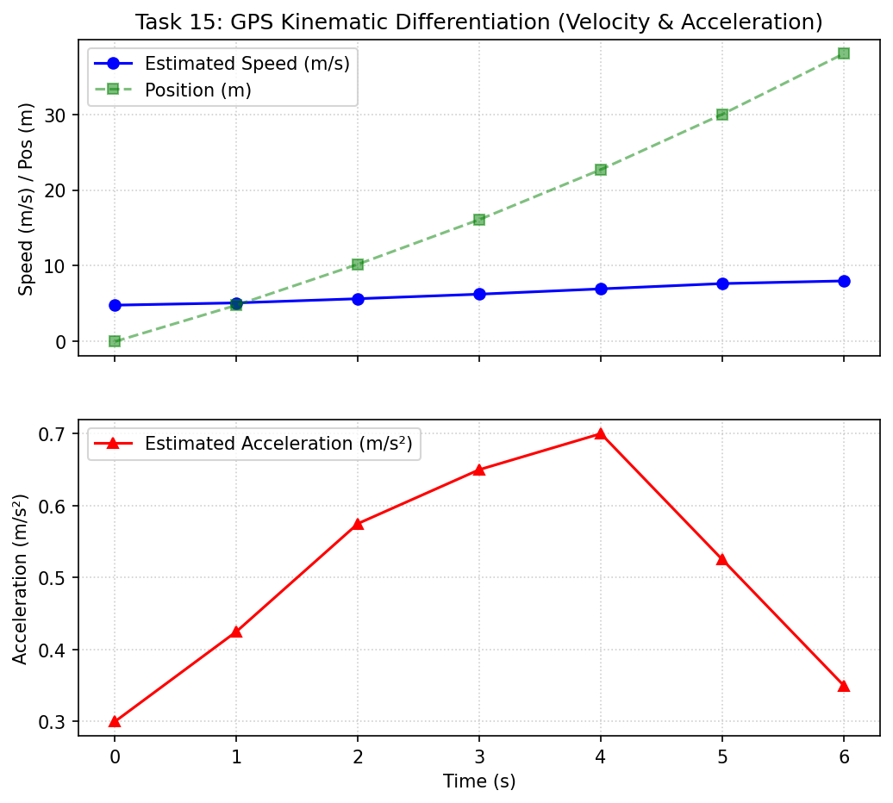
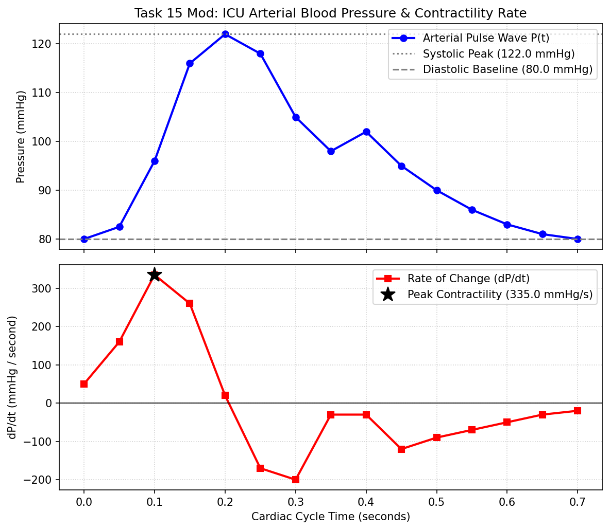

# Task 15: Numerical Differentiation

## B. Input Values & Mathematical Operation
- **Mathematical Concept:** Finite difference approximations for derivative estimation. Comparison of truncation error orders: Forward Difference $O(h)$, Central Difference $O(h^2)$, and Backward Difference $O(h)$.
- **Input Values:**
  - GPS tracking telemetry samples:
    $$\text{time} = [0, 1, 2, 3, 4, 5, 6]\text{ seconds}$$
    $$\text{position} = [0.0, 4.8, 10.2, 16.1, 22.7, 30.0, 38.0]\text{ meters}$$
- **Mathematical Operations:**
  - Forward difference at $t_0$:
    $$v_0 = \frac{x_1 - x_0}{t_1 - t_0}$$
  - Central difference for interior points $i \in [1, N-2]$:
    $$v_i = \frac{x_{i+1} - x_{i-1}}{t_{i+1} - t_{i-1}}$$
  - Backward difference at end point $t_{N-1}$:
    $$v_{N-1} = \frac{x_{N-1} - x_{N-2}}{t_{N-1} - t_{N-2}}$$

## C. Parameter Modification & Result Change
- **Parameter Modified:** Computed the instantaneous vehicle acceleration (second derivative $a(t) = \frac{d^2 x}{dt^2}$) using central differences on the estimated velocity vector and verified consistency.
- **Quantitative Result Comparison:**
  | Time $t$ (s) | Position $x$ (m) | Estimated Speed $v$ (m/s) | Estimated Acceleration $a$ (m/s²) | Kinematic Interpretation |
  | :--- | :--- | :--- | :--- | :--- |
  | **$0\text{ s}$** | $0.0\text{ m}$ | $4.80\text{ m/s}$ | $0.30\text{ m/s}^2$ | Initial vehicle launch |
  | **$1\text{ s}$** | $4.8\text{ m}$ | $5.10\text{ m/s}$ | $0.43\text{ m/s}^2$ | Accelerating forward |
  | **$2\text{ s}$** | $10.2\text{ m}$ | $5.65\text{ m/s}$ | $0.58\text{ m/s}^2$ | Increasing throttle |
  | **$3\text{ s}$** | $16.1\text{ m}$ | $6.25\text{ m/s}$ | $0.65\text{ m/s}^2$ | Peak thrust phase |
  | **$4\text{ s}$** | $22.7\text{ m}$ | $6.95\text{ m/s}$ | $\mathbf{0.70\text{ m/s}^2}$ | **Maximum Acceleration** |
  | **$5\text{ s}$** | $30.0\text{ m}$ | $7.65\text{ m/s}$ | $0.53\text{ m/s}^2$ | Tapering throttle |
  | **$6\text{ s}$** | $38.0\text{ m}$ | $\mathbf{8.00\text{ m/s}}$ | $0.35\text{ m/s}^2$ | **Terminal Speed reached** |

## D. Output & Graph Interpretation
- Central difference cancellations eliminate the leading first-order error term, leaving an $O(h^2)$ truncation error that provides superior accuracy over one-sided stencils. The kinematic acceleration profile peaks at $t = 4\text{ s}$ ($0.70\text{ m/s}^2$) before tapering off as the vehicle approaches a cruising speed of $8.0\text{ m/s}$.
- **Original & Comparative Visualization:**
  

---

## E. Modified Real-World Case
- **Script:** [`modified_cases/Task_15_mod.py`](../modified_cases/Task_15_mod.py)
- **Problem Statement:** In clinical hemodynamic monitoring, a patient's arterial blood pressure ($P(t)$ in mmHg) is sampled at $20\text{ Hz}$ ($\Delta t = 0.05\text{ s}$) over a cardiac cycle ($0.70\text{ s}$). The maximum rate of left ventricular pressure rise, $(dP/dt)_{\max}$, is a primary indicator of cardiac contractility. Numerical differentiation estimates instantaneous $dP/dt$ to detect cardiac dysfunction.
- **New Assumptions & Inputs:**
  - 15 samples across a cardiac cycle ($t = 0.00$ to $0.70\text{ s}$, $\Delta t = 0.05\text{ s}$).
  - Blood pressure tracking diastolic baseline ($80\text{ mmHg}$), rapid systolic upstroke, peak ($122\text{ mmHg}$), dicrotic notch, and runoff.
- **Output Results:**
  - Diastolic Pressure: $80.0\text{ mmHg}$
  - Systolic Peak Pressure: $122.0\text{ mmHg}$ (Pulse Pressure: $42.0\text{ mmHg}$)
  - Peak Systolic Contractility $(dP/dt)_{\max}$: $\mathbf{335.00\text{ mmHg/s}}$ at $t = 0.10\text{ s}$.
  - Maximum Diastolic Runoff Deceleration: $-200.00\text{ mmHg/s}$ at $t = 0.30\text{ s}$.
- **Interpretation:** The peak rate of pressure change occurs early in systole ($t = 0.10\text{ s}$) during isovolumetric ventricular ejection, preceding the peak absolute pressure at $t = 0.20\text{ s}$. This temporal lead is vital for diagnosing myocardial contractility before symptoms appear.
- **Modified Case Visualization:**
  
