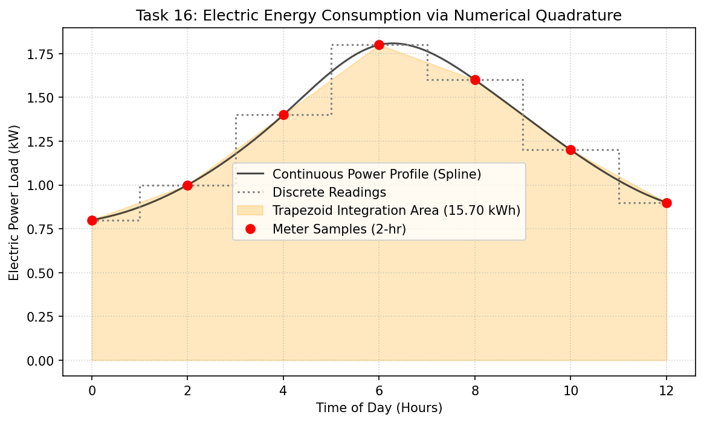
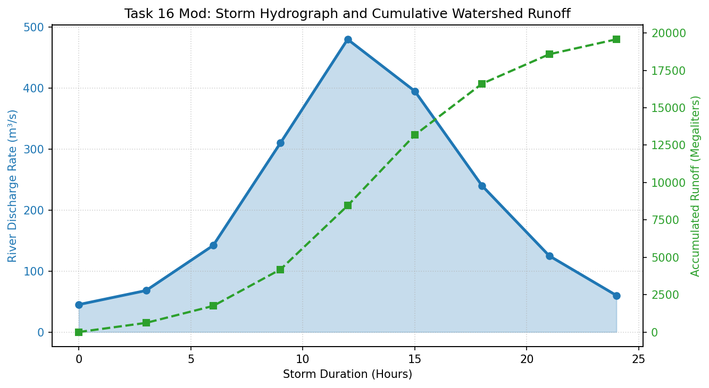

# Task 16: Numerical Integration

## B. Input Values & Mathematical Operation
- **Mathematical Concept:** Newton-Cotes closed quadrature rules for approximating definite integrals $\int_a^b f(x) dx$. Comparison between the composite Trapezoidal rule ($O(h^2)$ global error) and composite Simpson's $1/3$ parabolic rule ($O(h^4)$ global error).
- **Input Values:**
  - Smart electricity meter power demand readings sampled every 2 hours over a 12-hour duration:
    $$\text{time\_hours} = [0, 2, 4, 6, 8, 10, 12]$$
    $$\text{power\_kw} = [0.8, 1.0, 1.4, 1.8, 1.6, 1.2, 0.9]\text{ kW}$$
- **Mathematical Operations:**
  - Composite Trapezoidal Rule (`np.trapezoid`):
    $$E_{\text{trap}} = \sum_{i=0}^{N-2} \frac{P_i + P_{i+1}}{2}(t_{i+1} - t_i)$$
  - Composite Simpson's Rule (`scipy.integrate.simpson`):
    $$E_{\text{simp}} = \frac{h}{3} \left[ P_0 + 4 \sum_{i \text{ odd}} P_i + 2 \sum_{i \text{ even}} P_i + P_N \right]$$
  - Quadrature discrepancy: $|E_{\text{simp}} - E_{\text{trap}}|$.

## C. Parameter Modification & Result Change
- **Parameter Modified:** Evaluated numerical quadrature convergence under mesh refinement by interpolating the load curve onto finer temporal resolutions: $1$-hour grid ($N=13$) and $15$-minute grid ($N=49$).
- **Quantitative Result Comparison:**
  | Mesh Resolution | Trapezoidal Rule | Simpson's Rule | Discrepancy $|E_S - E_T|$ | Relative Difference |
  | :--- | :--- | :--- | :--- | :--- |
  | **2-hour Grid ($N=7$)** | $15.700\text{ kWh}$ | $15.800\text{ kWh}$ | $0.100\text{ kWh}$ | $0.63\%$ |
  | **1-hour Grid ($N=13$)** | $15.7348\text{ kWh}$ | $15.7464\text{ kWh}$ | $0.0116\text{ kWh}$ | $0.07\%$ |
  | **15-min Grid ($N=49$)** | $\mathbf{15.7457\text{ kWh}}$ | $\mathbf{15.7464\text{ kWh}}$ | $\mathbf{0.0007\text{ kWh}}$ | $\mathbf{0.004\%}$ |

## D. Output & Graph Interpretation
- Simpson's rule fits local second-degree parabolas over sub-intervals, delivering higher accuracy on smooth curves than linear trapezoids. As step size $h$ shrinks from $2\text{ hours}$ to $15\text{ minutes}$, the discrepancy drops from $100\text{ Wh}$ to under $1\text{ Wh}$, demonstrating $O(h^2)$ and $O(h^4)$ error decay.
- **Original & Comparative Visualization:**
  

---

## E. Modified Real-World Case
- **Script:** [`modified_cases/Task_16_mod.py`](../modified_cases/Task_16_mod.py)
- **Problem Statement:** During an extreme tropical storm event, a river basin gauging station records streamflow discharge $Q(t)$ ($\text{m}^3/\text{s}$) every 3 hours across a 24-hour flood hydrograph. Hydraulic engineers must compute total runoff volume $V = \int_0^{24} Q(t) dt$ (in cubic meters and Megaliters, ML) to assess downstream reservoir retention capacity.
- **New Assumptions & Inputs:**
  - Time intervals: $t \in [0, 3, 6, 9, 12, 15, 18, 21, 24]\text{ hr}$ ($\Delta t = 10,800\text{ s}$).
  - River discharge $Q(t) = [45, 68, 142, 310, 480, 395, 240, 125, 60]\text{ m}^3/\text{s}$.
- **Output Results:**
  - Peak Flood Discharge: $480.0\text{ m}^3/\text{s}$ at $t = 12\text{ hr}$.
  - Total Runoff (Trapezoidal Rule): $19,575,000\text{ m}^3$ ($19,575.0\text{ Megaliters}$).
  - Total Runoff (Simpson's Rule): $19,515,600\text{ m}^3$ ($19,515.6\text{ Megaliters}$).
  - Discrepancy: $59,400\text{ m}^3$ ($59.40\text{ ML}$, $0.30\%$).
- **Interpretation:** The trapezoidal rule slightly overestimates runoff volume during peak surge inflection ($t=9$ to $15\text{ hr}$) due to straight-line chords missing convex curvature. Simpson's parabolic integration accounts for non-linear cresting, ensuring accurate reservoir spillway sizing.
- **Modified Case Visualization:**
  
