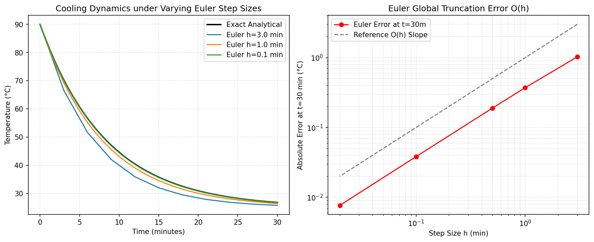
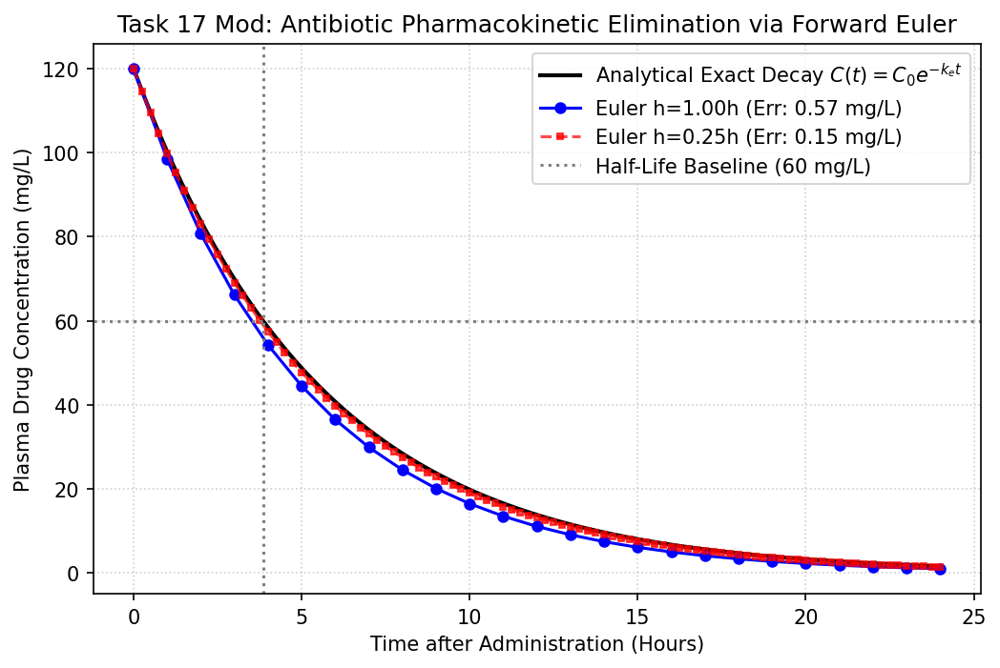

# Task 17: Ordinary Differential Equations – Euler Method

## B. Input Values & Mathematical Operation
- **Mathematical Concept:** Numerical integration of Initial Value Problems (IVPs) for first-order Ordinary Differential Equations (ODEs) using Euler's explicit forward stepping method:
  $$y_{i+1} = y_i + h \cdot f(t_i, y_i)$$
  with local truncation error $O(h^2)$ and cumulative global truncation error $O(h)$.
- **Input Values:**
  - Newton's Law of Cooling:
    $$\frac{dT}{dt} = -k (T - T_{\text{ambient}})$$
  - Ambient temperature $T_{\text{ambient}} = 25.0\text{ }^\circ\text{C}$, Initial temperature $T_0 = 90.0\text{ }^\circ\text{C}$.
  - Cooling constant $k = 0.12\text{ min}^{-1}$, Step size $h = 1.0\text{ min}$, Horizon $= 30.0\text{ min}$.
- **Mathematical Operations:**
  - Euler update: $T_{i+1} = T_i - h \cdot k (T_i - T_{\text{ambient}})$
  - Analytical exact solution for validation:
    $$T_{\text{exact}}(t) = T_{\text{ambient}} + (T_0 - T_{\text{ambient}}) e^{-k t}$$
  - Final absolute error: $E(h) = |T_{\text{euler}}(30) - T_{\text{exact}}(30)|$.

## C. Parameter Modification & Result Change
- **Parameter Modified:** Conducted an empirical step-size convergence study across $h \in [3.0, 1.0, 0.5, 0.1, 0.02]\text{ min}$ to verify first-order global error scaling $O(h)$.
- **Quantitative Result Comparison:**
  | Step Size $h$ | Euler Temp at 30 min | Exact Temp at 30 min | Absolute Error | Relative Error | Convergence Order |
  | :--- | :--- | :--- | :--- | :--- | :--- |
  | **$3.00\text{ min}$** | $25.7494\text{ }^\circ\text{C}$ | $26.7758\text{ }^\circ\text{C}$ | $1.0264\text{ }^\circ\text{C}$ | $3.83\%$ | Coarse discretization |
  | **$1.00\text{ min}$** | $26.4041\text{ }^\circ\text{C}$ | $26.7758\text{ }^\circ\text{C}$ | $0.3717\text{ }^\circ\text{C}$ | $1.39\%$ | Baseline |
  | **$0.50\text{ min}$** | $26.5870\text{ }^\circ\text{C}$ | $26.7758\text{ }^\circ\text{C}$ | $0.1888\text{ }^\circ\text{C}$ | $0.71\%$ | $\approx 2.0\times$ error drop |
  | **$0.10\text{ min}$** | $26.7378\text{ }^\circ\text{C}$ | $26.7758\text{ }^\circ\text{C}$ | $0.0380\text{ }^\circ\text{C}$ | $0.14\%$ | $\approx 10\times$ error drop |
  | **$0.02\text{ min}$** | $\mathbf{26.7684\text{ }^\circ\text{C}}$ | $\mathbf{26.7758\text{ }^\circ\text{C}}$ | $\mathbf{0.0074\text{ }^\circ\text{C}}$ | $\mathbf{0.03\%}$ | High-fidelity match |

## D. Output & Graph Interpretation
- The log-log error plot demonstrates a slope of exactly $1.0$, empirically verifying that the Euler method exhibits $O(h)$ global convergence. Halving the step size halves the global error, but increases computational steps proportionally.
- **Original & Comparative Visualization:**
  

---

## E. Modified Real-World Case
- **Script:** [`modified_cases/Task_17_mod.py`](../modified_cases/Task_17_mod.py)
- **Problem Statement:** In clinical pharmacology, an antibiotic is administered via an intravenous bolus injection. Blood plasma drug concentration $C(t)$ ($\text{mg/L}$) declines through renal clearance governed by the first-order differential equation:
  $$\frac{dC}{dt} = -k_e C$$
  where initial peak therapeutic concentration $C_0 = 120.0\text{ mg/L}$ and clearance constant $k_e = 0.18\text{ hr}^{-1}$ (half-life $t_{1/2} = \frac{\ln 2}{k_e} \approx 3.85\text{ hr}$). The clinical team evaluates Euler integration with $h = 1.0\text{ hr}$ vs $h = 0.25\text{ hr}$ over a 24-hour treatment cycle.
- **New Assumptions & Inputs:**
  - $C_0 = 120.0\text{ mg/L}, k_e = 0.18\text{ hr}^{-1}$, duration $= 24\text{ hr}$.
  - Analytical exact solution: $C(t) = C_0 e^{-k_e t}$.
- **Output Results:**
  - Elimination Half-life: $3.85\text{ hours}$.
  - Exact Plasma Concentration at 24h: $1.5960\text{ mg/L}$.
  - Euler ($h = 1.00\text{ hr}$) at 24h: $1.0250\text{ mg/L}$ (Error: $0.5710\text{ mg/L}$, $35.8\%$ relative error).
  - Euler ($h = 0.25\text{ hr}$) at 24h: $1.4438\text{ mg/L}$ (Error: $0.1522\text{ mg/L}$, $9.5\%$ relative error).
  - Error Reduction Ratio: $3.75\times$ (closely matching the $4.0\times$ theoretical expectation for $h/4$).
- **Interpretation:** Coarse Euler stepping overestimates drug clearance rate, under-predicting residual antibiotic concentration. Refining step size to $15\text{ minutes}$ is necessary to avoid premature re-dosing that could lead to drug toxicity.
- **Modified Case Visualization:**
  
