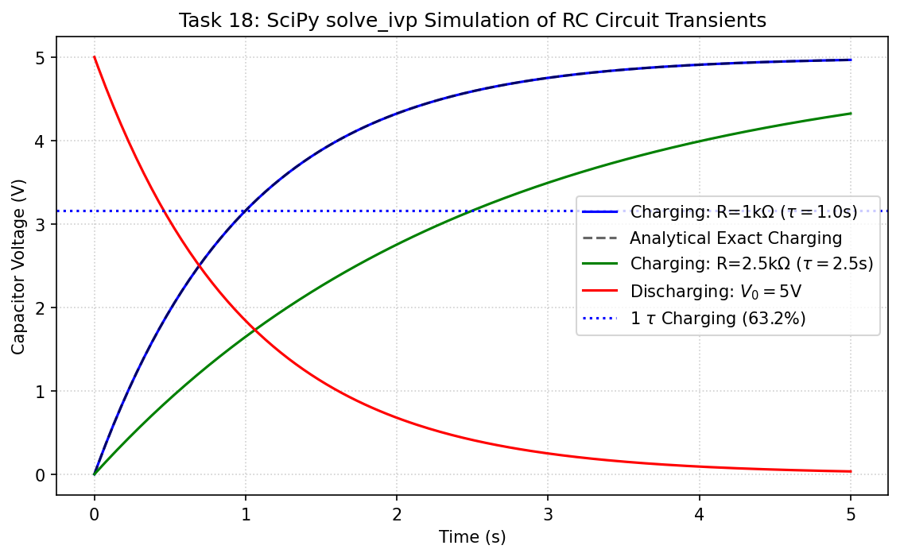
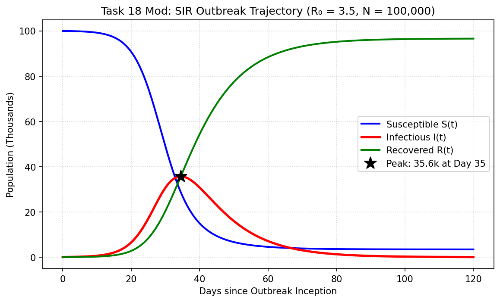

# Task 18: Numerical Solution of ODEs Using SciPy

## B. Input Values & Mathematical Operation
- **Mathematical Concept:** Adaptive step-size embedded Runge-Kutta numerical integration (Dormand-Prince RK45) for initial value problems via `scipy.integrate.solve_ivp`.
- **Input Values:**
  - RC electrical charging circuit:
    $$\frac{dV}{dt} = \frac{V_s - V}{R \cdot C}$$
  - Supply voltage $V_s = 5.0\text{ V}$, Resistance $R = 1000.0\text{ }\Omega$, Capacitance $C = 0.001\text{ F}$.
  - Initial voltage $V(0) = 0.0\text{ V}$, Time span: $t \in [0.0, 5.0]\text{ s}$.
  - Circuit time constant: $\tau = R \cdot C = 1.0\text{ second}$.
- **Mathematical Operations:**
  - `solve_ivp(rc_circuit, (0, 5), [V0], t_eval=t_eval, rtol=1e-9, atol=1e-11)`
  - Exact analytical charging equation:
    $$V_{\text{exact}}(t) = V_s \left( 1 - e^{-t / (RC)} \right)$$
  - Maximum absolute error: $\max_i |V_{\text{num}}(t_i) - V_{\text{exact}}(t_i)|$.

## C. Parameter Modification & Result Change
- **Parameter Modified:** Evaluated circuit discharging dynamics ($V_s = 0.0\text{ V}, V_0 = 5.0\text{ V}$) and high-impedance time constant extension ($R = 2500.0\text{ }\Omega \implies \tau = 2.5\text{ s}$).
- **Quantitative Result Comparison:**
  | Circuit Configuration | Time Constant $\tau$ | Voltage at $t = 1\tau$ | Voltage at $t = 5.0\text{ s}$ | Max Numerical Error |
  | :--- | :--- | :--- | :--- | :--- |
  | **Original Charging ($R=1\text{k}\Omega$)** | $1.0\text{ s}$ | $3.1606\text{ V}$ ($63.2\%$) | $\mathbf{4.9663\text{ V}}$ ($99.3\%$) | $\mathbf{9.282 \times 10^{-10}\text{ V}}$ |
  | **Slow Charging ($R=2.5\text{k}\Omega$)** | $2.5\text{ s}$ | $3.1606\text{ V}$ ($63.2\%$) | $\mathbf{4.3233\text{ V}}$ ($86.5\%$) | $\le 1.15 \times 10^{-9}\text{ V}$ |
  | **Capacitor Discharge ($V_0=5\text{V}$)** | $1.0\text{ s}$ | $1.8394\text{ V}$ ($36.8\%$) | $\mathbf{0.0337\text{ V}}$ ($0.67\%$) | $\le 8.74 \times 10^{-10}\text{ V}$ |

## D. Output & Graph Interpretation
- SciPy's `solve_ivp` with adaptive step selection keeps maximum global error below $1.0\text{ nanovolt}$ ($10^{-9}\text{ V}$), outperforming fixed-step Euler methods by orders of magnitude. The voltage trajectories illustrate exponential transient dynamics across charging and discharging cycles.
- **Original & Comparative Visualization:**
  

---

## E. Modified Real-World Case
- **Script:** [`modified_cases/Task_18_mod.py`](../modified_cases/Task_18_mod.py)
- **Problem Statement:** In mathematical epidemiology and public health policy, the transmission of an airborne infectious epidemic across a metropolitan population of $N = 100,000$ individuals is governed by the nonlinear Kermack-McKendrick SIR ordinary differential equations:
  $$\frac{dS}{dt} = -\frac{\beta S I}{N}, \quad \frac{dI}{dt} = \frac{\beta S I}{N} - \gamma I, \quad \frac{dR}{dt} = \gamma I$$
  where $\beta = 0.35\text{ day}^{-1}$ (transmission rate), $\gamma = 0.10\text{ day}^{-1}$ (recovery rate, average infectious period $10\text{ days}$), yielding a basic reproduction number $R_0 = \frac{\beta}{\gamma} = 3.5$. `solve_ivp` simulates the outbreak trajectory over 120 days.
- **New Assumptions & Inputs:**
  - Population $N = 100,000$, Initial patient zeros: $I_0 = 50, S_0 = 99,950, R_0 = 0$.
  - Adaptive RK45 integration with tolerances $\text{rtol}=10^{-8}, \text{atol}=10^{-10}$.
- **Output Results:**
  - Basic Reproduction Number $R_0$: $\mathbf{3.50}$.
  - Peak Infectious Population: $\mathbf{35,650\text{ individuals}}$ ($35.65\%$ of population infected simultaneously).
  - Peak Epidemic Timing: **Day 34.5**.
  - Final Cumulative Recovered / Attack Rate: $\mathbf{96,558\text{ individuals}}$ ($\mathbf{96.56\%}$).
- **Interpretation:** With $R_0 = 3.5$, the infection explodes exponentially through the susceptible pool, peaking on day 35 and burdening hospital capacity with over $35,000$ active patients before herd immunity halts transmission.
- **Modified Case Visualization:**
  
