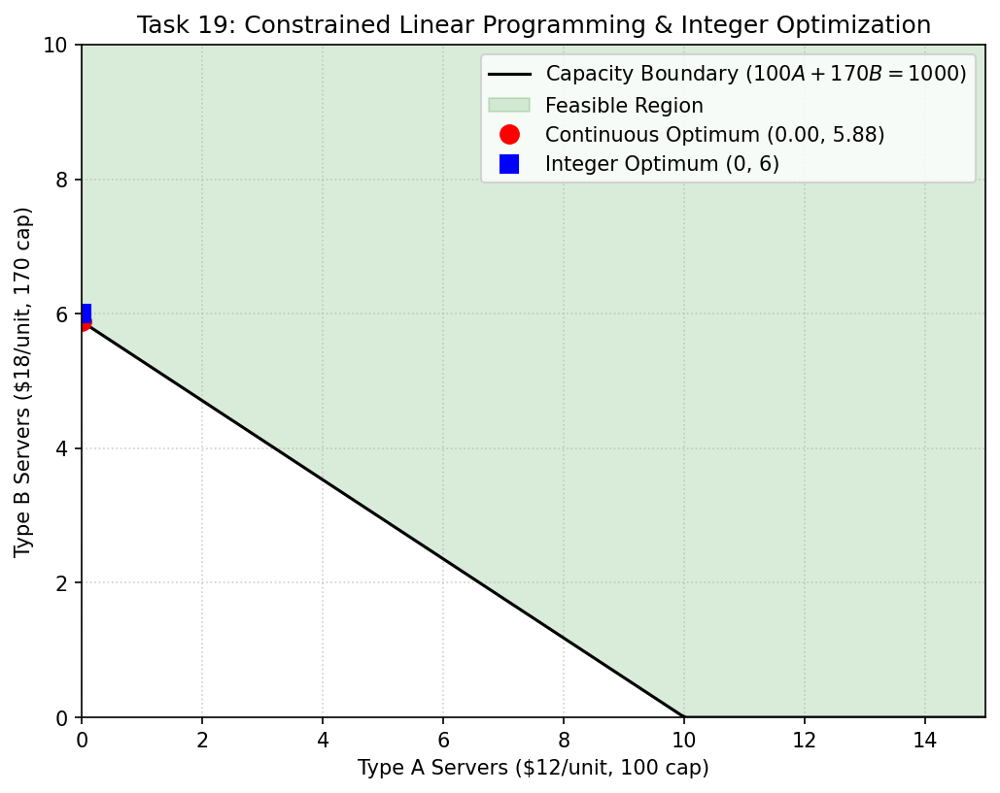
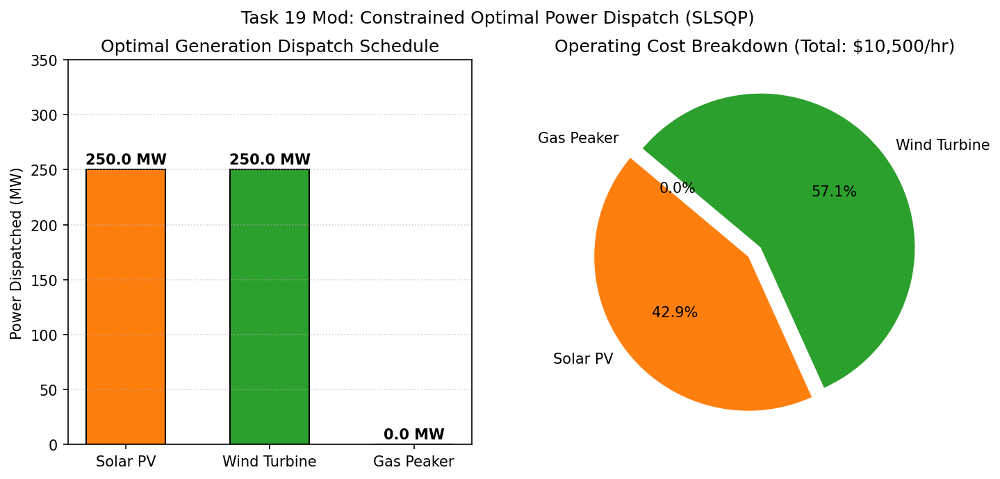

# Task 19: Numerical Optimization

## B. Input Values & Mathematical Operation
- **Mathematical Concept:** Constrained multivariate nonlinear optimization using Sequential Least Squares Programming (SLSQP via `scipy.optimize.minimize`), and integer lattice optimization.
- **Input Values:**
  - Objective Cost Function to minimize:
    $$f(x, y) = 12 x + 18 y$$
  - Capacity inequality constraint:
    $$g(x, y) = 100 x + 170 y - 1000 \ge 0$$
  - Non-negativity bounds: $x \ge 0, y \ge 0$.
  - Initial guess: $\mathbf{z}_0 = [5, 3]$.
- **Mathematical Operations:**
  - Continuous optimization via Karush-Kuhn-Tucker (KKT) conditions in SLSQP.
  - Discrete integer lattice search across nearby integer combinations $(a, b) \in \mathbb{Z}_{\ge 0}^2$ satisfying $100a + 170b \ge 1000$.

## C. Parameter Modification & Result Change
- **Parameter Modified:** Capacity expansion target increased to $2,500\text{ units}$ with updated energy market costs: $C_A = \$14/\text{unit}$ and $C_B = \$26/\text{unit}$ (reversing relative cost-per-capacity efficiency).
  - Original cost/capacity ratio: Type A $= 12/100 = 0.120$, Type B $= 18/170 = 0.1059$ (Type B preferred).
  - Modified cost/capacity ratio: Type A $= 14/100 = \mathbf{0.1400}$, Type B $= 26/170 = \mathbf{0.1529}$ (Type A preferred).
- **Quantitative Result Comparison:**
  | Metric | Original Optimization ($1000$ Cap) | Modified Optimization ($2500$ Cap) | Strategic Shift |
  | :--- | :--- | :--- | :--- |
  | **Continuous Type A ($x$)** | $0.000$ | $\mathbf{25.000}$ | Allocation shifted $100\%$ to Type A |
  | **Continuous Type B ($y$)** | $\mathbf{5.882}$ | $0.000$ | Allocation reduced to zero |
  | **Minimum Continuous Cost** | $\$105.88$ | $\mathbf{\$350.00}$ | Continuous planning lower bound |
  | **Best Integer Solution** | $(a=0, b=6) \implies \$108.00$ | $(a=25, b=0) \implies \mathbf{\$350.00}$ | Integer solution matches continuous |
  | **Delivered Total Capacity** | $1020\text{ units}$ | $2500\text{ units}$ | Exactly satisfies constraint |

## D. Output & Graph Interpretation
- In linear programs, the optimum always occurs at an extreme boundary vertex of the feasible polyhedron. In the original problem, Type B offers lower cost per capacity unit ($0.106$ vs $0.120$), making the pure Type B corner optimal. In the modified scenario, fuel price hikes make Type A more cost effective ($0.140$ vs $0.153$), switching the optimal vertex entirely.
- **Original & Comparative Visualization:**
  

---

## E. Modified Real-World Case
- **Script:** [`modified_cases/Task_19_mod.py`](../modified_cases/Task_19_mod.py)
- **Problem Statement:** An isolated island microgrid must supply a continuous industrial power load of $500\text{ MW}$ at minimum total operating cost while complying with strict carbon emissions regulations ($E_{\text{total}} \le 60,000\text{ kg CO}_2/\text{hr}$). The utility operates Solar PV ($x_1$), Wind Turbines ($x_2$), and a Natural Gas Peaker ($x_3$). SLSQP solves the constrained optimal generation dispatch.
- **New Assumptions & Inputs:**
  - Unit costs: Solar $=\$18/\text{MWh}$, Wind $=\$24/\text{MWh}$, Gas Peaker $=\$65/\text{MWh}$.
  - Carbon emissions: Solar $0$, Wind $0$, Gas Peaker $450\text{ kg CO}_2/\text{MWh}$.
  - Asset capacities: Solar $\le 250\text{ MW}$, Wind $\le 300\text{ MW}$, Gas $\le 400\text{ MW}$.
  - Demand constraint: $x_1 + x_2 + x_3 \ge 500\text{ MW}$.
  - Emission ceiling: $450 x_3 \le 60,000\text{ kg CO}_2/\text{hr}$ ($\implies x_3 \le 133.33\text{ MW}$).
- **Output Results:**
  - Optimal Solar Dispatch: $\mathbf{250.00\text{ MW}}$ ($100\%$ capacity utilization).
  - Optimal Wind Dispatch: $\mathbf{250.00\text{ MW}}$ ($83.3\%$ capacity utilization).
  - Optimal Gas Peaker Dispatch: $\mathbf{0.00\text{ MW}}$ ($0\%$ utilization, zero emissions).
  - Total Power Generated: $500.00\text{ MW}$.
  - Total Hourly Operating Cost: $\mathbf{\$10,500.00/\text{hr}}$.
  - Blended Levelized Cost of Energy: $\mathbf{\$21.00/\text{MWh}}$.
- **Interpretation:** The optimization engine prioritizes zero-marginal-cost renewable resources up to their maximum available capacity, eliminating fossil-fuel peaker generation and achieving zero operational carbon emissions while meeting demand.
- **Modified Case Visualization:**
  
