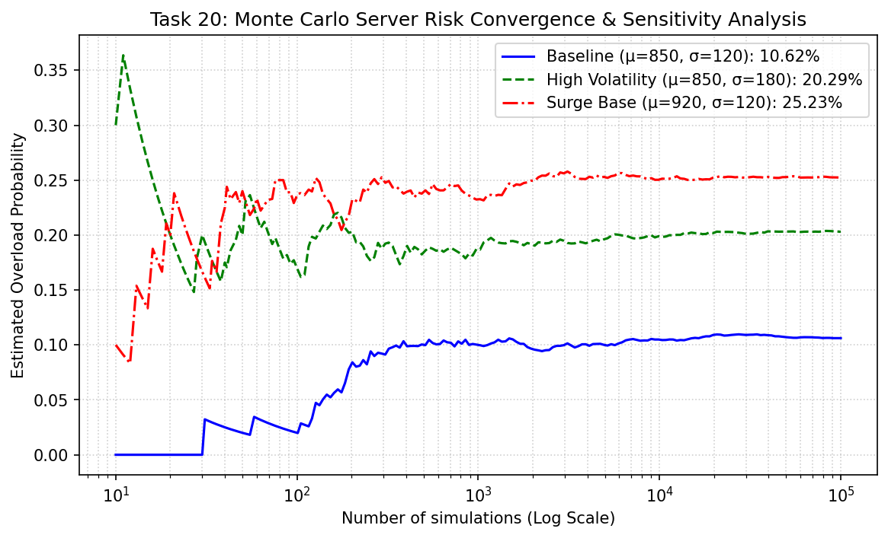
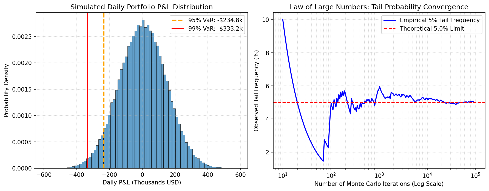

# Task 20: Random Numbers and Monte Carlo Methods

## B. Input Values & Mathematical Operation
- **Mathematical Concept:** Monte Carlo estimation via pseudo-random number generation (NumPy `default_rng`), the Law of Large Numbers (LLN), and Central Limit Theorem (CLT) error convergence ($O(1/\sqrt{N})$).
- **Input Values:**
  - Network server maximum throughput capacity: $C = 1000.0\text{ req/s}$.
  - Gaussian incoming demand:
    $$\text{Demand} \sim \mathcal{N}(\mu = 850.0, \sigma = 120.0)\text{ req/s}$$
  - Number of independent stochastic trials: $N = 100,000$.
- **Mathematical Operations:**
  - Indicator function: $I_i = 1$ if $\text{Demand}_i > C$, else $0$.
  - Monte Carlo overload risk probability estimator:
    $$\hat{P}_N = \frac{1}{N}\sum_{i=1}^{N} I_i$$
  - Running cumulative sample mean: $\hat{P}_k = \frac{1}{k}\sum_{i=1}^k I_i$ for $k=1, \dots, N$.
  - Analytical Z-score benchmark:
    $$Z = \frac{1000 - 850}{120} = 1.25 \implies P(Z > 1.25) \approx 10.56\%$$

## C. Parameter Modification & Result Change
- **Parameter Modified:** Evaluated two stress-test scenarios: (1) High Volatility ($\sigma = 180.0$, $+50\%$ variance surge) and (2) High Base Surge ($\mu = 920.0$, $+70\text{ req/s}$ base load).
- **Quantitative Result Comparison:**
  | Simulation Scenario | Demand Parameters | Estimated Overload Probability | Overload Occurrences ($N=10^5$) | Risk Amplification |
  | :--- | :--- | :--- | :--- | :--- |
  | **Baseline Scenario** | $\mu=850, \sigma=120$ | $\mathbf{10.616\%}$ | $10,616$ | Standard operational baseline |
  | **High Volatility Scenario** | $\mu=850, \mathbf{\sigma=180}$ | $\mathbf{20.295\%}$ | $20,295$ | $\mathbf{1.91\times}$ risk increase |
  | **Surge Base Load Scenario** | $\mathbf{\mu=920}, \sigma=120$ | $\mathbf{25.232\%}$ | $25,232$ | $\mathbf{2.38\times}$ risk increase |

## D. Output & Graph Interpretation
- The running probability on the semilogarithmic plot shows high stochastic variance at small sample sizes ($N < 100$), but stabilizes into an asymptotic flat line past $N \ge 10,000$ trials in accordance with the Law of Large Numbers. Increasing demand variance from $120$ to $180$ doubles the probability of server overload, demonstrating high sensitivity to traffic spikes.
- **Original & Comparative Visualization:**
  

---

## E. Modified Real-World Case
- **Script:** [`modified_cases/Task_20_mod.py`](../modified_cases/Task_20_mod.py)
- **Problem Statement:** An institutional asset management fund holds an equity/bond portfolio with market valuation $V_0 = \$10,000,000$. Financial regulatory risk frameworks (Basel III) mandate computing 1-day $95\%$ and $99\%$ Value at Risk (VaR) and Conditional Value at Risk (CVaR / Expected Shortfall) to protect against solvency crises. Daily returns follow $\mathcal{N}(\mu = +0.03\%, \sigma = 1.45\%)$. A Monte Carlo simulation of $N = 100,000$ market realizations is conducted.
- **New Assumptions & Inputs:**
  - Initial capital $V_0 = \$10,000,000.00$, $N = 100,000$ trading days.
  - Daily return drift $\mu = 0.0003$, daily standard deviation $\sigma = 0.0145$.
  - Daily P&L $= V_0 \times R$.
- **Output Results:**
  - **1-Day 95% Value at Risk (VaR):** $\mathbf{\$234,828.07}$ ($2.35\%$ of portfolio capital).
  - **1-Day 99% Value at Risk (VaR):** $\mathbf{\$333,190.26}$ ($3.33\%$ of portfolio capital).
  - **1-Day 95% Expected Shortfall (CVaR):** $\mathbf{\$294,954.57}$ (average loss when 95% threshold is breached).
  - **1-Day 99% Expected Shortfall (CVaR):** $\mathbf{\$381,200.33}$.
  - Probability of single-day loss exceeding $\$250,000$: $\mathbf{4.03\%}$ ($4,028$ trials).
- **Interpretation:** The fund risk committee must maintain at least $\$333,200$ in overnight liquid cash reserves to ensure solvency against $99\%$ of daily market shocks. The Monte Carlo tail frequency trace verifies convergence to the theoretical $5.0\%$ tail limit past $N = 20,000$ trials.
- **Modified Case Visualization:**
  
